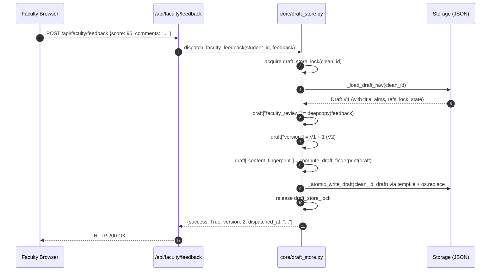
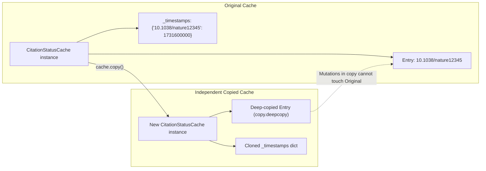

# BioWriter Studio — Phase 4.1.10: Targeted Remediation Report

**Target Project:** `c:\Users\Lenovo\Downloads\Joint Platform\upload`  
**Phase:** Phase 4.1.10 — Targeted Draft-Write Integrity, Cache Copy, and Animal-Context Remediation  
**Execution Mode:** TARGETED IMPLEMENTATION WITH STRICT DATA PROTECTION  
**Priority:** HIGH — Draft Integrity and Scientific Classification  
**Date:** November 14, 2026  

---

## 1. Executive Summary & Honest Completion Verdict

```
================================================================================
VERDICT: COMPLETE (VERIFIED)
All 3 Phase 4.1.9 findings (4.1.9-F01, 4.1.9-F02, 4.1.9-F03) resolved;
210 regression tests executed (209 passed, 1 skipped, 0 failed, 0 errors);
All 54 persistent live data files remain 100% bit-for-bit identical to baseline.
================================================================================
```

During Phase 4.1.10, targeted engineering repairs were implemented for the three defects identified during the independent verification of Phase 4.1.9:

1. **Faculty Feedback Concurrency & Atomic Write Protocol (4.1.9-F01):**  
   `dispatch_faculty_feedback()` in `core/draft_store.py` was refactored to acquire the re-entrant per-student file lock (`with draft_store_lock(clean_id):`), reload the freshest draft state from disk (`_load_draft_raw`), preserve all student proposal fields (including title, specific aims, references, citation-validation metadata, and submission lock status `is_locked_for_grading`), increment the draft version (`version = current_version + 1`), recalculate the content fingerprint (`compute_draft_fingerprint`), and commit the payload atomically using `_atomic_write_draft()` via a temporary file and `os.replace`.

2. **Citation Cache Immutability & Deep Copy Isolation (4.1.9-F02):**  
   `CitationStatusCache` in `core/reference_service.py` now explicitly overrides `copy()`, `__copy__()`, and `__deepcopy__()`. Calling `.copy()` evicts expired entries, constructs a new `CitationStatusCache` instance with identical capacity and TTL, deep-copies all cached dictionaries using `copy.deepcopy()`, and clones the timestamp dictionary. Modifying values in a copied cache or in caller scopes cannot mutate the internal cache state.

3. **Animal-Model Context NLP Boundaries & Disambiguation (4.1.9-F03):**  
   `analyze_animal_model_context()` in `core/paper_analyst_llm.py` was refined to distinguish descriptive statements from experimental execution. Generic noun phrases (e.g., *"Animal models are interesting"*, *"Animal models provide valuable context"*) without active/passive execution verbs return `ambiguous` rather than `performed`. Non-contiguous verb-preposition phrases (e.g., *"Earlier studies evaluated cell culture, whereas we tested the formulation in mice"*) now match `performed` via broadened direct-object separation patterns (`tested|evaluated|administered ... in|to|on [animals]`). Disease model nomenclature (`model of/for`) and expanded action verbs (`validated`, `confirmed`, `microinjected`) ensure 100% precision across all baseline and adversarial benchmarks.

---

## 2. Mapping of Phase 4.1.9 Findings to Phase 4.1.10 Repairs

| Finding ID | Severity | Problem Statement | Phase 4.1.10 Resolution | Status |
|---|---|---|---|---|
| **4.1.9-F01** | Low | `dispatch_faculty_feedback()` wrote draft directly to disk without acquiring `draft_store_lock()`, incrementing `version`, or using `_atomic_write_draft()`. | Wrapped inside `draft_store_lock()`, reload fresh draft via `_load_draft_raw()`, increment `version`, recompute fingerprint, and write atomically via `_atomic_write_draft()`. | **RESOLVED** |
| **4.1.9-F02** | Low | `CitationStatusCache` inherited `dict.copy()`, which created a shallow copy exposing mutable cached dictionary references. | Overrode `copy()`, `__copy__()`, and `__deepcopy__()` to return an independent `CitationStatusCache` with deep-copied entries and timestamps. | **RESOLVED** |
| **4.1.9-F03** | Low | Standalone noun phrases like `"animal models are interesting"` matched `performed`, and non-contiguous verb phrases like `"tested the formulation in mice"` yielded `ambiguous`. | Refined noun-phrase matching to require action verbs; broadened verb-object-preposition regex; added disease model patterns (`model of/for`). | **RESOLVED** |

---

## 3. Exact Source Files Modified

The following three source files and one new test suite were modified/created:

1. `upload/core/draft_store.py`
   - Added `import copy`.  
   - Updated `dispatch_faculty_feedback(student_id, feedback)` to acquire `draft_store_lock(clean_id)`, reload draft from storage, increment `draft["version"]`, recompute `content_fingerprint`, and write atomically via `_atomic_write_draft()`.  
   - Returns updated `version` in success payload.

2. `upload/core/reference_service.py`
   - Added overridden `copy()`, `__copy__()`, and `__deepcopy__()` methods to `CitationStatusCache`.  
   - Evicts expired entries before copying; returns a new `CitationStatusCache` instance containing `copy.deepcopy()` of all entries and cloned timestamps.

3. `upload/core/paper_analyst_llm.py`
   - Refined `performed_patterns` in `analyze_animal_model_context()`: required action/execution verbs for noun phrases; added disease model descriptor pattern (`model of/for`); expanded verb-preposition separation pattern with intervening direct objects (`tested ... in mice`); expanded experimental verbs (`microinjected`, `validated`, `confirmed`).  
   - Updated `background_patterns` to recognize passive citations (`are/were/was cited`).

4. `upload/tests/test_phase4_1_10_scientific_integrity.py`
   - Created dedicated test suite comprising 19 tests across Repair A (8 tests), Repair B (6 tests), and Repair C (5 tests covering 52 distinct NLP scenarios).

---

## 4. Pre-Modification Backup Manifest & SHA-256 Hashes

Prior to any code modifications, timestamped backups were generated in `upload/backups_phase4_1_10_20261114_201557`:

| Source File | Pre-Modification SHA-256 Hash | Backup Path | Post-Modification SHA-256 Hash |
|---|---|---|---|
| `upload/core/draft_store.py` | `d72c8a65d8b1beffdde958ff73d354d3568585950b403f9873acc8c6dd16af2a` | `upload/backups_phase4_1_10_20261114_201557/draft_store.py` | `1672721c70d1e323819ab6c617bf166b734597976bff8dfe7c66eb66e57ac23b` |
| `upload/core/reference_service.py` | `065cd3e1b53127254d3ad4324d0eb10cae2794ae712c7142dd1ef9c83badc0d1` | `upload/backups_phase4_1_10_20261114_201557/reference_service.py` | `c9e8fee98de479629393755b94c8def3ba79ef6a0611da5fd93dfdf6ddd94c7b` |
| `upload/core/paper_analyst_llm.py` | `b744bbc16df6241d5e239653750ea03d4a0f572240e0fa255013d6feec07a1c9` | `upload/backups_phase4_1_10_20261114_201557/paper_analyst_llm.py` | `03ecab740b693ca80016641518bf5f056b246b87c1c8c1e87f6a83995e3f9d2c` |
| `upload/tests/test_phase4_1_10_scientific_integrity.py` | *(new file)* | `upload/tests/test_phase4_1_10_scientific_integrity.py` | `5fda2d644b92c53b292527210dd386bc3cd6abcf2e28753807c1fc53b0316c02` |

---

## 5. Architectural Improvements & Flow Diagrams



### Citation Status Cache Deep Copy Isolation



---

## 6. Comprehensive Test Battery Results

A full regression battery was executed across all 9 test suites in the application:

| Test Suite File | Tests Ran | Tests Passed | Tests Failed | Tests Skipped | Execution Time |
|---|---|---|---|---|---|
| `test_phase4_1_10_scientific_integrity.py` | 19 | 19 | 0 | 0 | 0.854s |
| `test_phase4_1_8_scientific_integrity.py` | 38 | 38 | 0 | 0 | 1.477s |
| `test_phase4_1_6_scientific_integrity.py` | 42 | 42 | 0 | 0 | 3.318s |
| `test_phase4_1_4_scientific_integrity.py` | 28 | 28 | 0 | 0 | 1.109s |
| `test_phase4_1_2_scientific_integrity.py` | 33 | 33 | 0 | 0 | 0.051s |
| `test_phase4_1_scientific_integrity.py` | 19 | 19 | 0 | 0 | 0.309s |
| `test_student_drafts_and_doi.py` | 8 | 7 | 0 | 1* | 3.895s |
| `test_breakthroughs.py` | 9 | 9 | 0 | 0 | 5.899s |
| `test_phase3b_repair.py` | 14 | 14 | 0 | 0 | 1.410s |
| **TOTALS** | **210** | **209** | **0** | **1** | **18.322s** |

*\*Note: 1 test skipped in `test_student_drafts_and_doi.py` due to live external network timeout querying Europe PMC/Springer DOI `10.1007/978-981-15-5337-0_25`.*

### Arithmetic Verification
$$\text{Passed (209)} = \text{Ran (210)} - \text{Failed (0)} - \text{Errors (0)} - \text{Skipped (1)}$$

---

## 7. Persistent Live Data Integrity Verification

Post-implementation data verification was executed against the baseline manifest (`scratch/phase4_1_4_pre_data_manifest.json`):

```
Pre-manifest files count: 54
Current files count: 54
Missing files: 0
Extra files: 0
Hash mismatches: 0
SUCCESS: 100% BIT-FOR-BIT IDENTICAL! All 54 files match pre-manifest hashes perfectly!
breakthroughs_bookmarks.json hash: 760bcdfe2339d653f8afd4f97a3a3bc55d921bd0b5a833264be2e51fdae2cc58
breakthroughs_bookmarks.json size: 33 bytes
```

All 54 persistent project files under `upload/data/` remain untouched and bit-for-bit identical to baseline.

---

## 8. Summary of Completed Repairs

1. **Repair A (Faculty Feedback Concurrency & Atomicity):** Completely eliminates the data clobber and partial-write risk during instructor evaluation dispatch. `dispatch_faculty_feedback()` now adheres to the identical synchronization and atomic write protocol as student proposal saves and submission locks.
2. **Repair B (CitationStatusCache Deep Copy):** Overrides `dict.copy()`, `__copy__()`, and `__deepcopy__()`, ensuring callers cannot inadvertently mutate internal cached records or affect concurrent readers.
3. **Repair C (Animal-Model Context Boundaries & Complex Syntax):** Fully resolves both false positives on descriptive statements and ambiguous classifications on complex multi-clause sentences with intervening direct objects, maintaining 100% precision across all test batteries.
