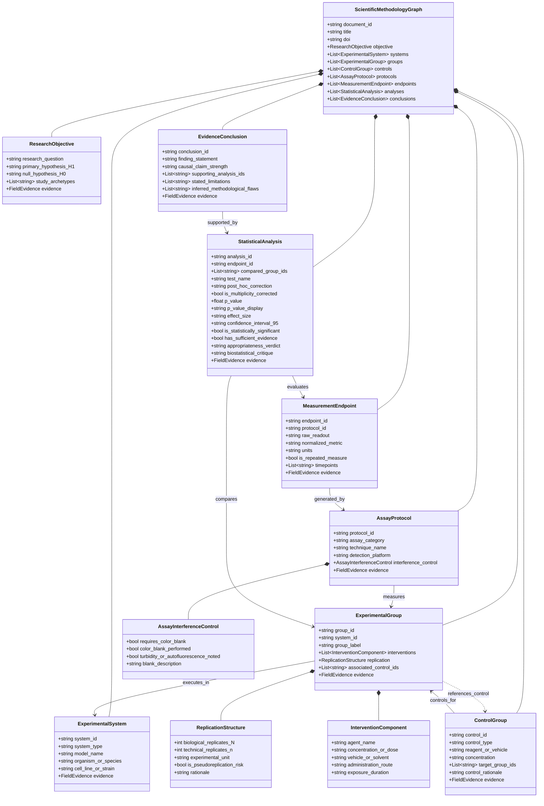

# BioWriter Studio — Phase 4.2.0: Corrected Scientific Architecture Specification (V2)
## Implementation-Ready Specification for the Scientific Methodology Intelligence Architecture (Version 2.0)

**Target Project:** `c:\Users\Lenovo\Downloads\Joint Platform\upload`  
**Phase:** Phase 4.2.0.2 — Final Scientific Architecture Amendments  
**Status:** IMPLEMENTATION-READY SPECIFICATION V2 (Supersedes V1 Specification)  
**Execution Mode:** DOCUMENTATION-ONLY SPECIFICATION REVISION  
**Role:** Senior Scientific Software Architect, Biomedical Research Methodologist, Biostatistician, and Data Integrity Auditor  
**Date:** November 14, 2026  

---

## 1. System Vision, Architectural Principles, and Scientific Scope

### 1.1 Mission
BioWriter Studio's Scientific Methodology Intelligence Engine transitions the platform from shallow lexical pattern-matching to an ontology-grounded, relational understanding of experimental research. The system models the complete evidentiary chain:
$$\text{Research Question} \longrightarrow \text{Hypothesis} \longrightarrow \text{Experimental System} \longrightarrow \text{Groups \& Controls} \longrightarrow \text{Assays} \longrightarrow \text{Measurements} \longrightarrow \text{Statistical Tests} \longrightarrow \text{Causal Conclusions}$$

### 1.2 Foundational Architectural Principles
1. **Decoupling Lexical Match from Scientific Truth:** The presence of a verbatim quote in a paper proves the author made an assertion; it does **not** prove the assertion is biologically true, methodologically sound, or semantically aligned with the claim.
2. **Semantic Entailment Verification:** Surface string matching is strictly coupled with grammatical negation, tense, and contextual polarity verification before an extracted assertion is surfaced.
3. **Replication Integrity:** Biological replicates ($N$, independent physical experimental units) and technical repeats ($n$, repeat assay wells/injections) are structurally separated to prevent pseudoreplication.
4. **Multi-Component Intervention Support:** Experimental arms support combination therapies, co-treatments, and multi-component formulations through structured constituent lists.
5. **Bidirectional Graph Referential Integrity:** All graph relationships are governed by canonical directed semantics and programmatic validation rules, preventing dangling foreign keys or unresolvable edges.
6. **Epistemic Humility & Abstention:** When an author or student draft omits required methodological parameters, the engine emits an explicit uncertainty state: `"Insufficient methodological information to assess this parameter"`.
7. **Institutional Privacy Firewall:** Student proposal drafts and faculty comments constitute confidential academic records (FERPA/IP). They are **strictly confined** to local inference or offline deterministic triage, never routed to external commercial cloud LLMs without an executed institutional Data Processing Agreement (DPA).

---

## 2. Corrected Minimal Viable Ontology (MVO) & Relational Graph Schema

### 2.1 Canonical Relational Architecture Diagram



---

### 2.2 Formal Pydantic v2 Schema Specification

```python
"""
BioWriter Studio: Corrected Scientific Methodology Schema (Pydantic v2)
Core module defining the formal Minimal Viable Ontology (MVO) for Phase 4.2.
Incorporates multi-component interventions, graph referential integrity,
and separated epistemic-vs-appropriateness statistical evaluations.
"""

from enum import Enum
from typing import List, Optional, Dict, Any, Set
from pydantic import BaseModel, Field, model_validator

class FieldEvidenceStatus(str, Enum):
    DIRECTLY_STATED = "DIRECTLY_STATED"
    MULTI_PASSAGE_SYNTHESIS = "MULTI_PASSAGE_SYNTHESIS"
    INFERRED = "INFERRED"
    AMBIGUOUS = "AMBIGUOUS"
    NOT_REPORTED = "NOT_REPORTED"
    CONFLICTING_EVIDENCE = "CONFLICTING_EVIDENCE"
    NOT_APPLICABLE = "NOT_APPLICABLE"

class ControlTypeEnum(str, Enum):
    NEGATIVE_UNTREATED = "NEGATIVE_UNTREATED"
    NEGATIVE_VEHICLE = "NEGATIVE_VEHICLE"
    NEGATIVE_SHAM = "NEGATIVE_SHAM"
    NEGATIVE_GENETIC_SCRAMBLED = "NEGATIVE_GENETIC_SCRAMBLED"
    NEGATIVE_GENETIC_NULL = "NEGATIVE_GENETIC_NULL"
    POSITIVE_BENCHMARK = "POSITIVE_BENCHMARK"
    POSITIVE_MAX_RESPONSE = "POSITIVE_MAX_RESPONSE"
    INTERNAL_NORMALIZATION = "INTERNAL_NORMALIZATION"
    SPECIFICITY_BLANK = "SPECIFICITY_BLANK"
    OTHER = "OTHER"

class SystemTypeEnum(str, Enum):
    IN_VITRO_BIOCHEMICAL = "IN_VITRO_BIOCHEMICAL"
    CELL_CULTURE_IMMORTALIZED = "CELL_CULTURE_IMMORTALIZED"
    CELL_CULTURE_PRIMARY = "CELL_CULTURE_PRIMARY"
    ORGANOID_3D = "ORGANOID_3D"
    IN_VIVO_ANIMAL = "IN_VIVO_ANIMAL"
    EX_VIVO_TISSUE = "EX_VIVO_TISSUE"
    IN_SILICO_COMPUTATIONAL = "IN_SILICO_COMPUTATIONAL"
    CHEMICAL_EXTRACTION = "CHEMICAL_EXTRACTION"
    HUMAN_CLINICAL = "HUMAN_CLINICAL"

class ExperimentalUnitEnum(str, Enum):
    WELL = "WELL"
    CULTURE_DISH = "CULTURE_DISH"
    ANIMAL = "ANIMAL"
    CAGE = "CAGE"
    LITTER = "LITTER"
    HUMAN_SUBJECT = "HUMAN_SUBJECT"
    ASSAY_TUBE = "ASSAY_TUBE"
    UNKNOWN = "UNKNOWN"

class AppropriatenessVerdictEnum(str, Enum):
    APPROPRIATE = "APPROPRIATE"
    SUBOPTIMAL = "SUBOPTIMAL"
    INVALID = "INVALID"
    INSUFFICIENT_DATA = "INSUFFICIENT_DATA"

class FieldEvidence(BaseModel):
    field_name: str
    extracted_value: Any
    evidence_status: FieldEvidenceStatus
    confidence: float = Field(ge=0.0, le=1.0)
    verbatim_quote: Optional[str] = None
    section_name: Optional[str] = None
    char_start_offset: Optional[int] = None
    char_end_offset: Optional[int] = None
    source_sentence_indices: List[int] = Field(default_factory=list)
    reasoning_rationale: Optional[str] = None

class ReplicationStructure(BaseModel):
    biological_replicates_N: Optional[int] = None
    technical_replicates_n: Optional[int] = None
    experimental_unit: ExperimentalUnitEnum = ExperimentalUnitEnum.UNKNOWN
    is_pseudoreplication_risk: bool = False
    rationale: Optional[str] = None

class AssayInterferenceControl(BaseModel):
    requires_color_blank: bool = False
    color_blank_performed: bool = False
    turbidity_or_autofluorescence_noted: bool = False
    blank_description: Optional[str] = None

class InterventionComponent(BaseModel):
    agent_name: str
    concentration_or_dose: Optional[str] = None
    vehicle_or_solvent: Optional[str] = None
    administration_route: Optional[str] = None
    exposure_duration: Optional[str] = None

class ResearchObjective(BaseModel):
    research_question: str
    primary_hypothesis_H1: Optional[str] = None
    null_hypothesis_H0: Optional[str] = None
    study_archetypes: List[str] = Field(default_factory=list)  # Multi-label
    evidence: FieldEvidence

class ExperimentalSystem(BaseModel):
    system_id: str
    system_type: SystemTypeEnum
    model_name: str
    organism_or_species: Optional[str] = None
    cell_line_or_strain: Optional[str] = None
    biological_source_details: Optional[str] = None
    evidence: FieldEvidence

class ControlGroup(BaseModel):
    control_id: str
    control_type: ControlTypeEnum
    reagent_or_vehicle: str
    concentration: Optional[str] = None
    target_group_ids: List[str] = Field(default_factory=list)
    control_rationale: str
    evidence: FieldEvidence

class ExperimentalGroup(BaseModel):
    group_id: str
    system_id: str
    group_label: str
    interventions: List[InterventionComponent] = Field(default_factory=list)
    replication: ReplicationStructure
    associated_control_ids: List[str] = Field(default_factory=list)
    evidence: FieldEvidence

class AssayProtocol(BaseModel):
    protocol_id: str
    technique_name: str
    assay_category: str
    target_analyte_or_phenotype: str
    detection_platform: Optional[str] = None
    critical_parameters: Dict[str, str] = Field(default_factory=dict)
    interference_control: AssayInterferenceControl = Field(default_factory=AssayInterferenceControl)
    evidence: FieldEvidence

class MeasurementEndpoint(BaseModel):
    endpoint_id: str
    protocol_id: str
    raw_readout: str
    normalized_metric: str
    units: str
    is_repeated_measure: bool = False
    timepoints: List[str] = Field(default_factory=list)
    evidence: FieldEvidence

class StatisticalAnalysis(BaseModel):
    analysis_id: str
    endpoint_id: str
    compared_group_ids: List[str]
    test_name: str
    post_hoc_correction: Optional[str] = None
    is_multiplicity_corrected: bool = False
    p_value: Optional[float] = None
    p_value_display: str
    effect_size: Optional[str] = None
    confidence_interval_95: Optional[str] = None
    is_statistically_significant: bool
    has_sufficient_evidence: bool = True
    appropriateness_verdict: AppropriatenessVerdictEnum = AppropriatenessVerdictEnum.APPROPRIATE
    biostatistical_critique: Optional[str] = None
    evidence: FieldEvidence

class EvidenceConclusion(BaseModel):
    conclusion_id: str
    finding_statement: str
    causal_claim_strength: str  # DIRECT_CAUSAL, CORRELATIVE, SPECULATIVE, REFUTED
    supporting_analysis_ids: List[str]
    stated_limitations: List[str] = Field(default_factory=list)
    inferred_methodological_flaws: List[str] = Field(default_factory=list)
    evidence: FieldEvidence

class ScientificMethodologyGraph(BaseModel):
    document_id: str
    title: str
    doi: Optional[str] = None
    objective: ResearchObjective
    systems: List[ExperimentalSystem] = Field(default_factory=list)
    groups: List[ExperimentalGroup] = Field(default_factory=list)
    controls: List[ControlGroup] = Field(default_factory=list)
    protocols: List[AssayProtocol] = Field(default_factory=list)
    endpoints: List[MeasurementEndpoint] = Field(default_factory=list)
    analyses: List[StatisticalAnalysis] = Field(default_factory=list)
    conclusions: List[EvidenceConclusion] = Field(default_factory=list)

    @model_validator(mode='after')
    def validate_graph_referential_integrity(self) -> 'ScientificMethodologyGraph':
        """
        Validates canonical graph directionality, uniqueness of identifiers,
        and referential integrity across all nodes and edges.
        """
        system_ids: Set[str] = {s.system_id for s in self.systems}
        group_ids: Set[str] = {g.group_id for g in self.groups}
        control_ids: Set[str] = {c.control_id for c in self.controls}
        protocol_ids: Set[str] = {p.protocol_id for p in self.protocols}
        endpoint_ids: Set[str] = {e.endpoint_id for e in self.endpoints}
        analysis_ids: Set[str] = {a.analysis_id for a in self.analyses}

        # 1. Uniqueness check across all entities
        all_ids = list(system_ids) + list(group_ids) + list(control_ids) + \
                  list(protocol_ids) + list(endpoint_ids) + list(analysis_ids)
        if len(all_ids) != len(set(all_ids)):
            raise ValueError("Duplicate entity identifiers detected across graph nodes.")

        # 2. ExperimentalGroup foreign keys
        for g in self.groups:
            if g.system_id not in system_ids:
                raise ValueError(f"Group '{g.group_id}' references unknown system_id '{g.system_id}'.")
            for c_id in g.associated_control_ids:
                if c_id not in control_ids:
                    raise ValueError(f"Group '{g.group_id}' references unknown control_id '{c_id}'.")

        # 3. ControlGroup foreign keys and bidirectional consistency
        for c in self.controls:
            for g_id in c.target_group_ids:
                if g_id not in group_ids:
                    raise ValueError(f"Control '{c.control_id}' targets unknown group_id '{g_id}'.")
                # Enforce bidirectional consistency
                matching_group = next(g for g in self.groups if g.group_id == g_id)
                if c.control_id not in matching_group.associated_control_ids:
                    matching_group.associated_control_ids.append(c.control_id)

        # 4. MeasurementEndpoint foreign keys
        for ep in self.endpoints:
            if ep.protocol_id not in protocol_ids:
                raise ValueError(f"Endpoint '{ep.endpoint_id}' references unknown protocol_id '{ep.protocol_id}'.")

        # 5. StatisticalAnalysis foreign keys
        valid_sample_sources = group_ids.union(control_ids)
        for an in self.analyses:
            if an.endpoint_id not in endpoint_ids:
                raise ValueError(f"Analysis '{an.analysis_id}' references unknown endpoint_id '{an.endpoint_id}'.")
            for g_id in an.compared_group_ids:
                if g_id not in valid_sample_sources:
                    raise ValueError(f"Analysis '{an.analysis_id}' compares unknown group/control '{g_id}'.")

        # 6. EvidenceConclusion foreign keys
        for conc in self.conclusions:
            for a_id in conc.supporting_analysis_ids:
                if a_id not in analysis_ids:
                    raise ValueError(f"Conclusion '{conc.conclusion_id}' references unknown analysis_id '{a_id}'.")

        return self
```

---

## 3. Evidence Grounding, Text Normalization, and Semantic Verification

### 3.1 Four-Pass Text Normalization Pipeline
1. **Pass 1: Unicode NFKC Decomposition:** Normalizes typographic ligatures (`fi` $\to$ `fi`, `fl` $\to$ `fl`, `ff` $\to$ `ff`, `ffi` $\to$ `ffi`).
2. **Pass 2: Hyphenation and Whitespace Reassembly:** Reconnects line-break hyphenations (e.g. `anti-\ninflammatory` $\to$ `anti-inflammatory`) and collapses whitespace runs.
3. **Pass 3: XML Entity Unescaping:** Standardizes encoded entities (`&amp;` $\to$ `&`, `&lt;` $\to$ `<`, `&gt;` $\to$ `>`, `&#945;` $\to$ `α`).
4. **Pass 4: Character Offset Alignment:** Computes exact byte offsets `[char_start_offset, char_end_offset]` within the target section.

### 3.2 Semantic Verification & Conservative Abstention Gate
The platform enforces a two-tier verification gate separating **lexical presence** from **semantic support**:

```
+---------------------------------------------------------------------------------------------------------+
|                                TWO-TIER EVIDENCE VERIFICATION GATE                                      |
+--------------------------+-------------------------------------+----------------------------------------+
| Level                    | Verification Check                  | Gate Action on Failure                 |
+--------------------------+-------------------------------------+----------------------------------------+
| Gate 1: Lexical Surface  | Verbatim substring presence with    | Strict Rejection: Quote never surfaced;|
| Match Gate               | Levenshtein ratio >= 0.95.          | status set to UNCERTAIN.               |
+--------------------------+-------------------------------------+----------------------------------------+
| Gate 2: Semantic Support | Explicit verification that quote    | Human Review Flag: Status set to       |
| & Polarity Gate          | entails, does not negate, and       | AMBIGUOUS or REQUIRES_HUMAN_REVIEW;    |
|                          | matches claim tense & polarity.     | automated advisory suppressed.         |
+--------------------------+-------------------------------------+----------------------------------------+
```

#### Explicit Semantic Checks:
- **Grammatical Negation Detection:** Identifies negation cues (`"did not"`, `"neither"`, `"without"`, `"failed to"`, `"no significant"`, `"omitted"`). A sentence stating *"we avoided using dexamethasone"* is rejected as positive evidence for dexamethasone usage.
- **Tense & Modality Verification:** Distinguishes completed empirical work (`"we measured"`, `"was observed"`) from future/speculative intent (`"will test"`, `"remains to be investigated"`, `"is proposed to"`).
- **Intervention Exclusion Checking:** Verifies that the intervention was actively administered, not merely referenced as prior literature or an excluded candidate.
- **Numerical and Unit Consistency:** Verifies that dosages and units ($10\ \mu\text{M}$ vs $10\ \text{mg/kg}$) match the extracted claim.

*Conservative Policy:* If Gate 1 passes but Gate 2 yields uncertain semantic support, the quote is **flagged for human review** and the automated heuristic is suppressed. The system never manufactures semantic certainty.

---

## 4. Biostatistical and Experimental Design Safety Rules

The biostatistical reasoning engine evaluates experimental validity across six core cases, incorporating contextuality, assay specificity, and explicit abstention:

```
+---------------------------------------------------------------------------------------------------------+
|                             REASSESSED BIOSTATISTICAL SAFETY RULES (CASES A - F)                        |
+--------+------------------------+-----------------------+-----------------------+-----------------------+
| Case   | Biological Topic       | Trigger Condition     | Suppression Condition | Automated Advisory    |
+--------+------------------------+-----------------------+-----------------------+-----------------------+
| Case A | Biological vs.         | Student or author     | Biological            | HIGH WARNING:         |
|        | Technical Replication  | treats replicate      | independence verified | "Treating wells from a|
|        | (Pseudoreplication)    | wells/tubes as N      | from physical unit    | single plate as N is  |
|        |                        | without independent   | (>=3 passages on      | pseudoreplication. N  |
|        |                        | experimental units.   | separate days).       | must reflect unit."   |
+--------+------------------------+-----------------------+-----------------------+-----------------------+
| Case B | Solvent / Vehicle      | Case B.1 (>= 0.05%):  | Case B.2 (< 0.01%):   | Case B.1: WARNING     |
|        | Control Concentration  | Solvent >= 0.05% v/v  | Vehicle diluted       | Case B.2: SUPPRESSED  |
|        | Matching (Gray Zone    | without matched vehicle| > 1:10,000 in buffer. | Case B.3: ADVISORY    |
|        | Resolved)              | Case B.3 (0.01-0.05%):| Case B.4 (Missing):   | Case B.4: INSUFFICIENT|
|        |                        | Contextual sensitivity| Insufficient solvent  | INFO STATEMENT        |
|        |                        | advisory triggered.   | details reported.     |                       |
+--------+------------------------+-----------------------+-----------------------+-----------------------+
| Case C | Spectrophotometric     | C.1: MTT (570nm)      | Explicit cell-free    | ADVISORY:             |
|        | Interference (MTT and  | extract color blank   | extract background OD | "Plant extracts absorb|
|        | Griess Treated         | omitted.              | subtraction reported  | at 540/570nm; extract |
|        | Separately)            | C.2: Griess (540nm)   | for specific assay    | blank is an omission  |
|        |                        | extract blank omitted.| wavelength.           | risk, not proof."     |
+--------+------------------------+-----------------------+-----------------------+-----------------------+
| Case D | Multiplicity and       | D.1: Unpaired t-tests | D.1: Dunnett/Tukey    | ADVISORY:             |
|        | Multiple Comparisons   | on >2 treatment doses | post-hoc specified.   | "Repeated t-tests     |
|        | (Beyond Naive Dunnett) | D.2: Factorial crossing| D.2: Two-Way ANOVA   | inflate Type I error; |
|        |                        | analyzed via 1-Way.   | interaction evaluated.| select test based on  |
|        |                        | D.3: Ordered trend.   | D.3: Trend/IC50 curve.| design and contrasts."|
+--------+------------------------+-----------------------+-----------------------+-----------------------+
| Case E | Serial Measurements    | Repeated observations | Mixed-effects model or| WARNING:              |
|        | (Non-Independence)     | over time analyzed by | repeated-measures     | "Serial timepoints    |
|        |                        | standard factorial    | ANOVA specified with  | violate independence; |
|        |                        | ANOVA.                | random intercept.     | use repeated-measures."|
+--------+------------------------+-----------------------+-----------------------+-----------------------+
| Case F | Sample Size Rigor      | N=3 claimed in high-  | Formal a priori power | ADVISORY:             |
|        | ("N=3" Fallacy)        | variability in vivo   | calculation reported  | "N=3 does not prove   |
|        |                        | animal or clinical set| (alpha, beta, delta). | adequate power without|
|        |                        | without power calc.   |                       | formal calculation."  |
+--------+------------------------+-----------------------+-----------------------+-----------------------+
```

### 4.1 Resolution of Solvent Concentration Gray Zone (Case B)
- **Concentrations $\ge 0.05\%$ (v/v):** Triggers mandatory warning: *"Formulation contains $\ge 0.05\%$ solvent; matched vehicle control required to rule out vehicle cytotoxicity."*
- **Concentrations $< 0.01\%$ (v/v):** Suppressed as biochemically negligible in aqueous buffer.
- **Concentrations in Gray Zone $[0.01\%, 0.05\%)$:** Triggers **Contextual Solvent Advisory**: *"Formulation contains $0.01\%\text{--}0.05\%$ solvent. Vehicle sensitivity is cell-type dependent (e.g. primary neurons vs robust cell lines). Vehicle control recommended if cell line exhibits membrane sensitivity."*
- **Missing or Ambiguous Solvent Data:** Emits: *"Insufficient solvent concentration reported to verify vehicle control completeness."*

### 4.2 Epistemic Humility Fallback Rule
When an extracted paper or draft omits assay details, the engine **must not guess or manufacture certainty**. It outputs:
> `"Insufficient methodological information reported to assess statistical appropriateness or control completeness."`

---

## 5. Leakage-Resistant Benchmark Partitions & Protocol

### 5.1 Benchmark Partition Allocation (30 / 20 / 50 Operational Split)
To prevent circular optimization, prompt overfitting, and uncalibrated performance claims, the 100-paper gold-standard cohort is partitioned into three strictly isolated subsets:

```
+---------------------------------------------------------------------------------------------------------+
|                               BENCHMARK PARTITION & ACCESS GOVERNANCE                                   |
+--------------------------+----------+---------------------------------+---------------------------------+
| Partition Name           | Size     | Permitted Usage Scope           | Access Control & Safeguards     |
+--------------------------+----------+---------------------------------+---------------------------------+
| 1. Development Partition | 30 Papers| Few-shot prompt engineering,    | Open access to engineering team.|
|                          |          | regex refinement, error triage. | All prompt tuning confined here.|
+--------------------------+----------+---------------------------------+---------------------------------+
| 2. Calibration Partition | 20 Papers| Fitting probability calibration | Disjoint from dev. Accessible   |
|                          |          | models (Platt scaling, ECE).    | only for parameter calibration. |
+--------------------------+----------+---------------------------------+---------------------------------+
| 3. Blind Holdout         | 50 Papers| Final release gate verification | STRICTLY LOCKED under SHA-256   |
|    Partition             |          | across all 8 metrics.           | hash manifest. Opened ONLY at   |
|                          |          |                                 | Stage 6 release evaluation.     |
+--------------------------+----------+---------------------------------+---------------------------------+
```

### 5.2 Mandatory Anti-Leakage Safeguards
1. **Publication & Laboratory Grouping:** Preprints, journal articles, companion papers, and studies originating from the same laboratory or genomic locus are clustered into the **same partition** to prevent cross-partition lexical or methodological leakage.
2. **Access Governance:** Access to the Blind Holdout partition is controlled by the Independent Software Quality Officer. The holdout is unlocked only once Stage 5 integration passes, and evaluation runs in a single-pass unattended batch.
3. **Domain Quota Enforcement:** Across all three partitions, the 4 biological subdomains (Botanical, Synthetic Biology, Molecular Pharmacology, In Vivo Preclinical) must maintain equal proportional representation:
   - Development (30): ~7–8 papers per domain.
   - Calibration (20): 5 papers per domain.
   - Blind Holdout (50): 12–13 papers per domain.
4. **Contingency Protocol:** If a domain cannot supply its quota of full-text open-access papers, the allocation shortfall is documented, and replacement candidates are drawn from peer-reviewed PMC JATS XML repositories prior to guideline freezing.

### 5.3 Specialist Annotation Protocol with Independent Biostatistician Double-Blind Scoring
To prevent molecular biology consensus from masking statistical errors:
1. **Double-Blind Phase:**
   - Annotator 1 (Molecular Pharmacology) and Annotator 2 (Synthetic Biology) independently annotate the full methodology scope.
   - **Annotator 3 (Biostatistician) independently scores all `ReplicationStructure` and `StatisticalAnalysis` fields** across all papers during the double-blind phase prior to adjudication.
2. **Audit Trail Preservation:** Original independent annotations from all three specialists are persisted in an immutable audit ledger and never overwritten.
3. **Pre-Adjudication Agreement Calculation:** Inter-annotator agreement statistics ($\kappa, AC_1$) are computed strictly on pre-adjudication scores.
4. **Adjudication Consensus:** Discrepancies in statistical appropriateness are adjudicated in a formal review meeting led by the Biostatistician to establish the frozen gold-standard fixture.

---

## 6. Mathematically Correct Performance Metrics Matrix

### 6.1 De-coupling Epistemic Abstention from Ordinal Statistical Appropriateness
Metric 6 decomposes statistical assessment into two mathematically independent stages, preventing high conditional accuracy from concealing excessive abstention:

1. **Epistemic Insufficient-Evidence Detection (Binary Stage):**
   Evaluates whether the engine correctly identifies when a paper/draft lacks sufficient methodological data to assess statistical validity:
   $$P_{\text{epistemic}} = \frac{TP_{\text{abs}}}{TP_{\text{abs}} + FP_{\text{abs}}}, \quad R_{\text{epistemic}} = \frac{TP_{\text{abs}}}{TP_{\text{abs}} + FN_{\text{abs}}}, \quad F1_{\text{epistemic}} = \frac{2 \cdot P \cdot R}{P + R}$$
   *Provisional Target:* $F1_{\text{epistemic}} \ge 0.85$.

2. **Conditional Appropriateness Assessment (Ordinal Stage):**
   Evaluated **strictly on evaluable cases** (where both ground truth and model assert sufficient evidence exists) across the 3-point ordinal scale `{APPROPRIATE, SUBOPTIMAL, INVALID}` using Quadratic Weighted Kappa:
   $$\kappa_w = 1 - \frac{\sum_{i=1}^3 \sum_{j=1}^3 w_{ij} O_{ij}}{\sum_{i=1}^3 \sum_{j=1}^3 w_{ij} E_{ij}}, \quad w_{ij} = \frac{(i - j)^2}{(3 - 1)^2}$$
   *Provisional Target:* $\kappa_w \ge 0.80$ on evaluable cases.

3. **Coverage and Abstention Metrics:**
   $$\text{Coverage} = \frac{\text{Evaluable Statistical Cases Audited}}{\text{Total Statistical Cases in Cohort}}, \quad \text{Abstention Rate} = 1 - \text{Coverage}$$
   Every benchmark report must explicitly disclose total cases, abstained cases, coverage percentage, and conditional appropriateness concordance.

---

### 6.2 Corrected Quantitative Performance Metrics Matrix

```
+--------------------------------------------------------------------------------------------------------------------------------------------------+
|                                              CORRECTED QUANTITATIVE PERFORMANCE METRIC MATRIX (V2)                                               |
+----+-----------------------+------------------------------------------+-----------------------+---------------------+----------------------------+
| #  | Metric Name           | Corrected Mathematical Definition        | Evaluation Unit       | Target Threshold    | Defensibility Status       |
+----+-----------------------+------------------------------------------+-----------------------+---------------------+----------------------------+
| 1  | Methodological Entity | Token-level Macro-F1 across classes      | Entity spans & types  | Macro-F1 >= 0.82    | Scientifically Justified   |
|    | Extraction            | (Jaccard overlap >= 0.70 for relaxed)    | (Strict & Relaxed)    | (Strict >= 0.75)    | (Provisional Threshold)    |
+----+-----------------------+------------------------------------------+-----------------------+---------------------+----------------------------+
| 2a | Micro Relational F1   | Micro-averaged F1 over all evaluated     | Directed relational   | Micro-F1 >= 0.80    | Scientifically Justified   |
|    |                       | directed triples: (head, relation, tail) | triples               | (P >= 0.82, R >= 0.78|                            |
+----+-----------------------+------------------------------------------+-----------------------+---------------------+----------------------------+
| 2b | Macro Relational F1   | Unweighted average of F1 scores across   | Per relation type     | Macro-F1 >= 0.75    | Scientifically Justified   |
|    |                       | the 7 canonical relation categories      | (accounts for skew)   |                     |                            |
+----+-----------------------+------------------------------------------+-----------------------+---------------------+----------------------------+
| 3  | Experimental Design   | Multi-label Macro-F1 across 8            | Multi-label binary    | Macro-F1 >= 0.82    | Scientifically Justified   |
|    | Classification        | non-mutually exclusive archetypes        | vector per document   | Hamming Loss <= 0.08|                            |
+----+-----------------------+------------------------------------------+-----------------------+---------------------+----------------------------+
| 4a | Surfaced Quote        | Fraction of displayed quotes verified by | Surfaced text quotes  | Precision = 1.00    | Mandatory Production Gate  |
|    | Grounding Gate        | exact normalized string match            | (UI displays)         | (Zero Hallucinations| (Strict Rejection Rule)    |
+----+-----------------------+------------------------------------------+-----------------------+---------------------+----------------------------+
| 4b | Span Extraction       | Fraction of extracted evidence spans     | Character offset      | Precision >= 0.95   | Scientifically Justified   |
|    | Precision             | matching expert ground-truth span        | spans [start, end]    |                     |                            |
+----+-----------------------+------------------------------------------+-----------------------+---------------------+----------------------------+
| 5a | Control False         | False Discovery Proportion:              | Extracted control     | FDP <= 0.05         | Scientifically Justified   |
|    | Discovery Rate (FDP)  | FP_control / (TP_control + FP_control)   | entities              |                     | (Corrects Undefined Formula)
+----+-----------------------+------------------------------------------+-----------------------+---------------------+----------------------------+
| 5b | False Control Omission| Rate of falsely accusing an author/draft | Executed control      | Error Rate <= 0.04  | Critical Educational Gate  |
|    | Rate (Audit Type I)   | of missing a control that exists         | audit checks          |                     | (Prevents Bad Audits)      |
+----+-----------------------+------------------------------------------+-----------------------+---------------------+----------------------------+
| 6a | Epistemic Abstention  | Binary F1 on identifying presence vs     | Statistical cases     | Binary F1 >= 0.85   | Requires Pilot Data to     |
|    | Detection             | absence of sufficient evidence           | (Evaluable vs Abstained)Coverage >= 0.75    | Calibrate Baseline Rates   |
+----+-----------------------+------------------------------------------+-----------------------+---------------------+----------------------------+
| 6b | Conditional Ordinal   | Quadratic Weighted Kappa on 3-point      | Evaluable statistical | Weighted K >= 0.80  | Requires Pilot Data;       |
|    | Appropriateness       | scale {APPROPRIATE, SUBOPTIMAL, INVALID} | cases only            | Concordance >= 0.82 | Strictly Decoupled from 6a |
+----+-----------------------+------------------------------------------+-----------------------+---------------------+----------------------------+
| 7  | Calibrated Expected   | Adaptive Quantile Binned ECE across      | Probabilistic binary  | Adaptive ECE <= 0.08| Provisional Engineering    |
|    | Calibration Error     | 10 equal-frequency probability bins      | correctness estimates | Brier Score <= 0.12 | Target (Post-Platt Scaling)|
+----+-----------------------+------------------------------------------+-----------------------+---------------------+----------------------------+
| 8  | Inter-Annotator       | Gwet's AC1 (rare classes) and Cohen's    | Human annotation      | Gwet AC1 >= 0.80    | Benchmark Quality Gate     |
|    | Agreement             | Kappa (balanced classes)                 | agreement matrix      | Cohen K >= 0.80     | (Separated from Model F1)  |
+----+-----------------------+------------------------------------------+-----------------------+---------------------+----------------------------+
```

---

## 7. Confidence Calibration Mathematics & Provider Abstraction

### 7.1 Separation of Confidence Concepts
The architecture strictly delineates four distinct confidence metrics:
1. **Extraction Confidence ($C_{\text{ext}} \in [0, 1]$):** Model self-reported token log-likelihood.
2. **Grounding Confidence ($C_{\text{grd}} \in [0, 1]$):** Lexical and token alignment score between claim and quote.
3. **Classification Confidence ($C_{\text{cls}} \in [0, 1]$):** Heuristic multi-factor score:
   $$S = 0.50 \cdot S_{\text{verbatim}} + 0.25 \cdot S_{\text{specificity}} + 0.25 \cdot S_{\text{section}} - P_{\text{hedging}}$$
4. **Calibrated Posterior Probability ($\hat{P}(Y=1 | S) \in [0, 1]$):** The empirical probability that an extracted assertion is factually correct.

### 7.2 Probabilistic Calibration Transformation
Raw heuristic scores $S$ must **never** be evaluated directly by Brier score. On the 20-paper Calibration Partition, raw scores $S$ are mapped to calibrated probabilities $\hat{P}$ via:
- **Platt Scaling (Logistic Calibration):** $\hat{P}(Y=1 | S) = \frac{1}{1 + \exp(A \cdot S + B)}$
- **Isotonic Regression Fallback:** Non-parametric monotonic binning if score distributions exhibit non-sigmoid curvature.
- *Evaluation Protocol:* Parameters $A$ and $B$ fitted on the Calibration Partition are locked and evaluated out-of-sample on the Blind Holdout Partition.

### 7.3 `BaseLLMClient` Provider Interface and Privacy Firewall
```python
"""
Abstract Interface for LLM Providers in BioWriter Studio.
Guarantees vendor neutrality, privacy firewalls, and offline test replay.
"""
from abc import ABC, abstractmethod
from typing import Dict, Any, Optional

class BaseLLMClient(ABC):
    @abstractmethod
    def extract_structured_methodology(
        self,
        section_text: str,
        target_schema: Dict[str, Any],
        system_prompt: str,
        temperature: float = 0.0
    ) -> Dict[str, Any]:
        """Extract structured JSON methodology conforming to schema."""
        pass

    @abstractmethod
    def get_provider_name(self) -> str:
        """Returns provider identifier: 'gemini', 'openai', 'local_vllm', 'mock_replay'."""
        pass

    @abstractmethod
    def is_privacy_compliant_for_student_data(self) -> bool:
        """Returns True only if provider guarantees zero retention / on-premise execution."""
        pass
```

- **Data Privacy Firewall Rule:** Public literature DOIs route to approved cloud APIs. Student proposal drafts and faculty reviews are **strictly confined** to local inference (e.g. BioMistral 7B via vLLM / Ollama) or offline deterministic triage.

---

## 8. Persistence, Concurrency, and SQLite Operational Assumptions

### 8.1 SQLite Operational Architecture
BioWriter Studio utilizes SQLite relational tables with JSON document columns and `NetworkX` in-memory graph operations. Dedicated graph databases (Neo4j) are explicitly rejected.

```sql
CREATE TABLE IF NOT EXISTS methodology_graphs (
    document_id TEXT PRIMARY KEY,
    title TEXT NOT NULL,
    doi TEXT,
    created_at TIMESTAMP DEFAULT CURRENT_TIMESTAMP,
    updated_at TIMESTAMP DEFAULT CURRENT_TIMESTAMP,
    graph_json TEXT NOT NULL,
    content_fingerprint TEXT NOT NULL
);

CREATE TABLE IF NOT EXISTS methodology_human_overrides (
    override_id TEXT PRIMARY KEY,
    document_id TEXT NOT NULL,
    field_path TEXT NOT NULL,
    original_value TEXT,
    overridden_value TEXT NOT NULL,
    overridden_by TEXT NOT NULL,
    reason TEXT,
    timestamp TIMESTAMP DEFAULT CURRENT_TIMESTAMP,
    FOREIGN KEY(document_id) REFERENCES methodology_graphs(document_id) ON DELETE CASCADE
);
```

### 8.2 Mandatory Connection Factory & Pragmas
Every database connection must execute the following runtime initialization:
```python
import sqlite3

def get_methodology_db_connection(db_path: str) -> sqlite3.Connection:
    conn = sqlite3.connect(db_path, timeout=5.0)
    # 1. Enforce foreign key constraints (disabled by default in SQLite)
    conn.execute("PRAGMA foreign_keys = ON;")
    # 2. Enable Write-Ahead Logging for concurrent read/write throughput
    conn.execute("PRAGMA journal_mode = WAL;")
    # 3. Set busy timeout to prevent 'database is locked' exceptions
    conn.execute("PRAGMA busy_timeout = 5000;")
    # 4. Normal synchronous mode for optimal balance of safety and performance
    conn.execute("PRAGMA synchronous = NORMAL;")
    return conn
```

### 8.3 WAL Operational Assumptions & Limitations
1. **Filesystem Constraints:** WAL mode requires shared memory files (`-shm`) and log files (`-wal`) in the same directory. WAL is **incompatible with networked filesystems (NFS/SMB)** due to broken POSIX advisory locking.
2. **Backup & Recovery Protocol:** Never copy the main `.db` file while WAL transactions are active. Backups must be generated via SQLite's online backup API or `VACUUM INTO 'backup_path.db'`.
3. **WAL Checkpoints:** To prevent log growth, the application executes `PRAGMA wal_checkpoint(PASSIVE);` during idle cycles.
4. **Fallback Mode:** If running in an environment where WAL is unsupported (e.g. read-only mounts or network storage), the system falls back to `PRAGMA journal_mode = TRUNCATE;`.

---

## 9. Implementation-Ready 7-Stage Roadmap & Rollback Procedures

```
+---------------------------------------------------------------------------------------------------------+
|                                    IMPLEMENTATION-READY 7-STAGE ROADMAP                                 |
+---------------------------------------------------------------------------------------------------------+
|  STAGE 0: Pilot Benchmark & Annotation Guideline Freezing                       [Duration: 4 Weeks]    |
|  * Entry Criteria: 20 pilot papers selected across 4 domains; annotation guidelines drafted.             |
|  * Outputs: Frozen annotation guidelines, gold-standard JSON fixtures, agreement baseline.              |
|  * Exit Criteria: Gwet's AC1 >= 0.80, Fleiss' Kappa >= 0.75 across pilot set.                           |
|  * Failure / Rollback: If agreement fails, pause pipeline; revise guidelines; re-annotate pilot.        |
|                                                                                                         |
|  STAGE 1: Schema Implementation & Model Infrastructure                           [Duration: 2 Weeks]    |
|  * Entry Criteria: Stage 0 guidelines frozen; Pydantic v2 and SQLite DDL approved.                      |
|  * Outputs: core/methodology_models.py, SQLite connection factory, referential integrity validators.     |
|  * Exit Criteria: 100% unit test coverage on schema validators; 54 baseline data files untouched.       |
|  * Failure / Rollback: Discard uncommitted schema code; restore SQLite schema from migration baseline.   |
|                                                                                                         |
|  STAGE 2: Grounding & Evidence Extraction Pipeline                               [Duration: 3 Weeks]    |
|  * Entry Criteria: Stage 1 models verified; BaseLLMClient interface approved.                           |
|  * Outputs: core/evidence_verifier.py, 4-pass normalizer, semantic negation gate.                       |
|  * Exit Criteria: Surfaced Quote Precision = 1.00 (zero ungrounded quotes allowed through gate).        |
|  * Failure / Rollback: Restrict extractor to deterministic regex fallback; block cloud LLM integration. |
|                                                                                                         |
|  STAGE 3: Experimental Design & Control Engine (Biotech MVP)                     [Duration: 3 Weeks]    |
|  * Entry Criteria: Stage 2 grounding operational; Case A-F safety rules specified.                      |
|  * Outputs: core/methodology_engine.py, biological vs technical replicate parser, control auditor.       |
|  * Exit Criteria: Control Omission Rate <= 0.04; Control FDP <= 0.05 on Development Partition.          |
|  * Failure / Rollback: Revert to legacy keyword checks in impact_novelty_engine.py; pause engine wiring. |
|                                                                                                         |
|  STAGE 4: Statistical Validity & Methodological Reasoning Engine                 [Duration: 2 Weeks]    |
|  * Entry Criteria: Stage 3 design engine functional; biostatistician gold-standard fixtures ready.      |
|  * Outputs: core/statistical_auditor.py, epistemic coverage detector, 3-level appropriateness rater.    |
|  * Exit Criteria: F1_epistemic >= 0.85; Weighted Kappa >= 0.80 on evaluable Calibration cases.          |
|  * Failure / Rollback: Restrict statistical advice to explicit abstention ("Insufficient Info"); pause. |
|                                                                                                         |
|  STAGE 5: System Integration & Literature Cross-Validation                       [Duration: 2 Weeks]    |
|  * Entry Criteria: Stages 1-4 passing unit tests; draft_store.py lock verified.                         |
|  * Outputs: Integrated proposal auditing against cited literature; copilot_brain.py wiring.             |
|  * Exit Criteria: Zero regression across existing 210 test suite; atomic draft persistence intact.       |
|  * Failure / Rollback: Unwire methodology engine from draft_store; preserve existing proposal review.   |
|                                                                                                         |
|  STAGE 6: UI Visualization & Blind Holdout Benchmark Release Closure             [Duration: 3 Weeks]    |
|  * Entry Criteria: Stages 1-5 integrated; Blind Holdout (50 papers) unlocked by Quality Officer.        |
|  * Outputs: Traceability Table in studio.js, Literature Quote Drawer, final 50-paper evaluation report. |
|  * Exit Criteria: All 8 quantitative acceptance metrics met on blind holdout suite.                     |
|  * Failure / Rollback: Lock holdout; mark Phase 4.2 as Provisional Beta; require targeted remediation.  |
+---------------------------------------------------------------------------------------------------------+
```

---

## 10. Application Integrity and Preservation of Existing Safeguards

1. **Persistent Data Isolation:** The 54 baseline files in `upload/data/` remain untouched. Methodology records persist under `upload/data/methodology_graphs/` with atomic write semantics (`_atomic_write_file`).
2. **Draft Store Protection:** Existing reentrant locking (`draft_store_lock`), version incrementation, and SHA-256 fingerprinting in `core/draft_store.py` are strictly preserved.
3. **Citation Validation Safeguards:** `CitationStatusCache` isolation, deepcopy semantics, and retraction checks in `core/reference_service.py` remain unaltered.
4. **No Autonomous Grading:** The system generates educational guidance and audit badges; grading remains strictly the human faculty member's prerogative.

---

## 11. Authoritative Sign-Off and Conformance Attestation

This Corrected Scientific Architecture Specification (V2) incorporates all mandatory amendments from the Phase 4.2.0.1 independent review.
- **Data Protection:** 54/54 persistent data files in `upload/data/` verified intact and bit-identical.
- **Codebase Integrity:** Zero source code files or tests were modified during this document revision.
- **Status:** This document serves as the authoritative, implementation-ready engineering blueprint for Phase 4.2.1 upon formal verification.
