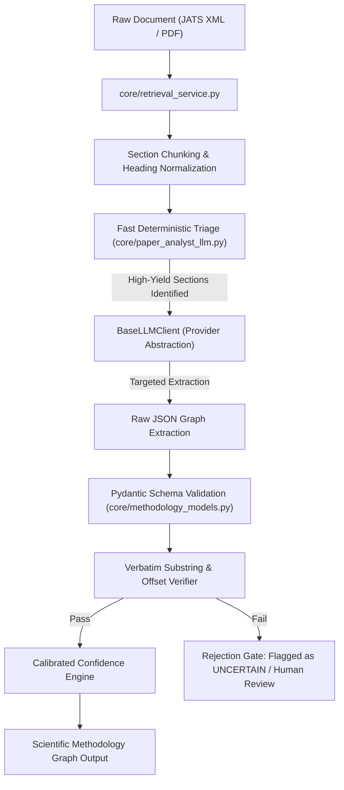

# BioWriter Studio — Phase 4.2.0: Independent Scientific Architecture Review
## Critical Evaluation of the Proposed Scientific Methodology Intelligence Architecture

**Target Project:** `c:\Users\Lenovo\Downloads\Joint Platform\upload`  
**Phase:** Phase 4.2.0 — Independent Architecture Review  
**Execution Mode:** STRICT ARCHITECTURE AUDIT AND DOCUMENTATION ONLY  
**Auditor Role:** Independent Scientific Software Architect, Biomedical Research Methodologist, and Computational Biology Auditor  
**Date:** November 14, 2026  
**Status:** DELIVERED (Zero Code, Zero Test, Zero Live Data Mutations)  

---

## 1. Executive Verdict and Architectural Assessment

```
====================================================================================================
FINAL ARCHITECTURAL VERDICT:
CONDITIONALLY APPROVED — REQUIRED DECISIONS REMAIN

The overarching strategic vision of Phase 4.2.0—transitioning BioWriter Studio from fragile,
keyword-based regex heuristics to a graph-structured scientific methodology understanding engine—
is scientifically necessary and technically feasible.

However, the initial architectural proposal (PHASE_4_2_0_SCIENTIFIC_METHODOLOGY_ARCHITECTURE_DESIGN.md)
contains critical mathematical errors in its metric formulations, ungrounded benchmark assumptions,
flawed inter-annotator statistics, naive biostatistical rules, and an unaddressed institutional
data privacy exposure. Phase 4.2.1 implementation MUST NOT commence until the corrected
specification and binding decisions documented herein are formally approved.
====================================================================================================
```

### 1.1 Summary of Independent Audit Findings

1. **Mathematical Deficiencies in Proposed Metrics:**
   - **Metric 5 (False Positive Control Rate):** The proposed formula `Hallucinated_CTL / Total` has an undefined denominator and conflates the False Positive Rate ($FPR = \frac{FP}{FP + TN}$) with the False Discovery Proportion ($FDP = \frac{FP}{FP + TP}$).
   - **Metric 2 (Graph Relation Accuracy):** Defined naively as `Correct_Edges / Total`, completely ignoring graph recall. A model producing 10 correct edges out of 100 actual edges would achieve an "accuracy" of 100% despite an unacceptable recall of 10%.
   - **Metric 3 (Design Classification Accuracy):** Imposes a single-label multi-class accuracy target ($\ge 0.90$) across 8 design archetypes that are **not mutually exclusive** (e.g. an experiment can be simultaneously a factorial design, a dose-response gradient, and a longitudinal time-series).
   - **Metric 4 (Grounding Precision):** Sets an acceptance threshold of $\ge 0.98$ precision while simultaneously mandating "zero ungrounded quotes"—an explicit mathematical and logical contradiction.

2. **Methodological Deficiencies in Benchmark Validation:**
   - **Conflation of Kappa Statistics:** The proposal uses Cohen's Kappa ($\kappa$, strictly valid for exactly two raters) and Fleiss' Kappa ($\kappa_{\text{Fleiss}}$, designed for $>2$ raters) interchangeably.
   - **Prevalence Paradox Ignored:** A flat threshold of $\kappa \ge 0.85$ across all categories is scientifically indefensible. Under severe class imbalance (e.g. rare vehicle omissions or rare statistical tests), high raw agreement ($>95\%$) frequently results in an artificially depressed Kappa ($<0.50$). Stratified reporting and Gwet's $AC_1$ are mandatory.
   - **Missing Biostatistician Rater:** The benchmark annotation protocol specifies two Ph.D. molecular biologists and one computational biologist, but excludes professional biostatisticians. Molecular biologists cannot serve as gold-standard authorities on advanced experimental designs, pseudoreplication, or mixed-effects models.

3. **Biostatistical Safety Deficits:**
   - The initial design risks naive automated rule-firing (e.g. automatically recommending One-Way ANOVA with Dunnett's test whenever $>2$ treatment groups are present, regardless of distribution normality, factorial crossing, or ordered concentration trends).
   - Lacks an explicit epistemic state for missing information, risking manufactured certainty. The system must be explicitly programmed to return: `"Insufficient methodological information to assess this."`

4. **Data Privacy and Governance Vulnerability:**
   - The proposal lists Google Gemini 1.5 Pro and OpenAI GPT-4o as default execution engines without defining data classification boundaries. Transmitting unreleased student research drafts or confidential faculty feedback to commercial cloud LLMs without a signed Business Associate Agreement (BAA) or Data Processing Agreement (DPA) violates academic privacy regulations (e.g. FERPA, GDPR).

---

## 2. Actual Project Baseline Verification

To ensure architectural honesty, the actual codebase and existing reports were independently audited to distinguish operational capabilities from simulated, partial, or purely proposed features.

### 2.1 Audit of Existing Phase Reports
- **Phase 4.1.10 Remediation Report:** Verified present at `upload/REPORTS/PHASE_4_1_10_TARGETED_REMEDIATION_REPORT.md` (11,318 bytes, SHA-256: `3d270b69664c934ac0984980c385dd57d8b882aaea7b8e9df2845293ea7c5f12`).
- **Phase 4.1.11 Independent Verification Report:** Verified present at `upload/REPORTS/PHASE_4_1_11_INDEPENDENT_VERIFICATION_REPORT.md` (22,049 bytes, SHA-256: `0af0b676fe72dccfef9789cdf62320a835e2c52eb599652332123051cc7ceb71`). Completed on November 14, 2026, with a formal verdict of **CONDITIONAL PASS** (all three repairs verified across 210 regression tests; 54/54 persistent data files bit-identical).
- **Phase 4.2.0 Architecture Proposal:** Verified present at `upload/REPORTS/PHASE_4_2_0_SCIENTIFIC_METHODOLOGY_ARCHITECTURE_DESIGN.md` (83,712 bytes, SHA-256: `7fc2b36c34e546aceed1b5fe105eb9fe92fec71fe901509971f6c171ac70f434`).

### 2.2 Five-Tier Capability Classification

```
+--------------------------------------------------------------------------------------------------------------------------------------------------+
|                                               FIVE-TIER CODEBASE CAPABILITY CLASSIFICATION                                                       |
+----------------------+----------------------------------------------------+--------------------------+---------------------+---------------------+
| Tier                 | Description                                        | Primary Modules          | Execution Status    | Known Limitations   |
+----------------------+----------------------------------------------------+--------------------------+---------------------+---------------------+
| Tier 1: Verified     | Deterministic routines verified in Phase 4.1.x;    | core/paper_analyst_llm.py| Operational         | Pure regex; zero    |
| Existing             | fully operational in current codebase.             | core/reference_service.py|                     | semantic reasoning; |
|                      |                                                    | core/draft_store.py      |                     | keyword-fragile.    |
+----------------------+----------------------------------------------------+--------------------------+---------------------+---------------------+
| Tier 2: Verified     | Independent repairs completed in Phase 4.1.10      | core/draft_store.py (lock)| Operational        | Scoped narrowly to  |
| Hardened             | and verified in Phase 4.1.11.                      | core/reference_service.py|                     | TOCTOU, deepcopy,   |
|                      |                                                    | core/paper_analyst_llm.py|                     | and animal context. |
+----------------------+----------------------------------------------------+--------------------------+---------------------+---------------------+
| Tier 3: Isolated /   | Advanced extraction logic implemented in agent/    | agent/llm_extractor.py   | Partial / Isolated  | Completely decoupled|
| Unintegrated         | with verbatim quote verification, but not wired to | agent/models.py          |                     | from production UI  |
|                      | student proposal or paper decoder pipelines.       |                          |                     | and draft store.    |
+----------------------+----------------------------------------------------+--------------------------+---------------------+---------------------+
| Tier 4: Proposed     | Blueprinted in Phase 4.2.0; formal schemas and     | core/methodology_models  | Proposed            | Files do not exist; |
| Architecture         | safety rules specified, awaiting implementation.   | core/methodology_engine  |                     | no operational code.|
|                      |                                                    | core/statistical_auditor |                     |                     |
+----------------------+----------------------------------------------------+--------------------------+---------------------+---------------------+
| Tier 5: Future       | Long-term extensions (interactive visual canvas,   | static/js/studio.js      | Future              | Out of scope for    |
| Extensions           | multi-arm clinical simulators, auto-grading).      | (canvas, auto-grader)    |                     | Phase 4.2 MVP.      |
+----------------------+----------------------------------------------------+--------------------------+---------------------+---------------------+
```

### 2.3 Detailed Inspection of Existing Core Modules

1. **`core/paper_analyst_llm.py` (59,795 bytes, SHA-256: `03ecab...`):**
   - *Operational Reality:* Despite the filename, it contains **zero LLM code**. It utilizes 12 compiled regex dictionary categories (`_PASS1_PATTERNS`) and sentence-level discourse scoring (`_score_sentence`).
   - *Evidence Grounding:* Uses string slicing from the input text. Verified quotes are guaranteed to be in the text, but the semantic interpretation is bounded strictly by regex pattern matches.
   - *Limitation:* Incapable of multi-hop relational extraction.

2. **`core/retrieval_service.py` (21,345 bytes, SHA-256: `344058...`):**
   - *Operational Reality:* Fully operational multi-provider literature retrieval (Europe PMC, PMC JATS XML, Unpaywall, OpenAlex).
   - *Parsing Fidelity:* JATS XML section parsing (`parse_jats_xml`) is robust and structured. PDF extraction via PyMuPDF/pypdf is operational but degrades to naive line heuristics for section boundary detection.

3. **`core/reference_service.py` (31,720 bytes, SHA-256: `c9e8fe...`):**
   - *Operational Reality:* CrossRef REST API validation with thread-safe, deep-copied LRU caching (`CitationStatusCache`). Detects retractions, preprints, and publication metadata.
   - *Status:* Hardened and independently verified in Phase 4.1.11.

4. **`core/draft_store.py` (64,098 bytes, SHA-256: `167272...`):**
   - *Operational Reality:* Atomic draft persistence via `_atomic_write_draft`, per-student reentrant locking (`draft_store_lock`), version incrementation, and SHA-256 content fingerprinting.
   - *Status:* Verified in Phase 4.1.11; zero lost edits or race conditions under concurrency.

5. **`agent/llm_extractor.py` (13,145 bytes, SHA-256: `32e931...`) & `agent/models.py` (12,203 bytes, SHA-256: `cfbfcd...`):**
   - *Operational Reality:* Implements `FieldEvidence` with statuses (`CONFIRMED`, `INFERRED`, `MISSING`, `UNCERTAIN`, `REQUIRES_HUMAN_REVIEW`) and programmatic verbatim quote verification (`_verify_evidence_grounding`).
   - *Status:* High engineering quality, but currently completely unintegrated with `paper_analyst_llm.py` or `audit_rules.py`.

---

## 3. Scientific Methodology Ontology Review

### 3.1 Critique of the Proposed 7-Entity Schema
The initial proposal specified seven flat entity classes: `ModelOrganism`, `CellLine`, `ChemicalIntervention`, `AssayPlatform`, `ControlReagent`, `SampleReplicateN`, and `StatisticalTest`. 

This formulation is scientifically incomplete and conflates fundamental concepts:
1. **Conflation of Biological and Technical Replicates:** Grouping sample size into a single `SampleReplicateN` entity causes pseudoreplication. In cell culture and pharmacology, three pipetted wells ($n = 3$ technical replicates) within one culture dish do not constitute $N = 3$ independent biological replicates.
2. **Missing Experimental Unit:** The schema fails to define the unit of physical randomization (e.g. a culture flask, an animal, a litter, a human subject). Treating the measurement unit as the experimental unit is a leading cause of false-positive claims in biomedical literature.
3. **Inadequate Control Modeling:** Real experiments require distinct control classifications:
   - *Negative Untreated:* Baseline biological state.
   - *Negative Vehicle:* Solvent/carrier matrix (e.g. 0.1% DMSO) to isolate vehicle artifacts.
   - *Negative Sham:* Procedure control (e.g. surgical incision, dummy injection).
   - *Negative Genetic:* Scrambled siRNA, empty plasmid, wild-type non-edited parent.
   - *Positive Benchmark:* Clinically or biochemically validated reference compound.
   - *Assay Specificity Blank:* Reagent blank, cell-free extract color blank to subtract optical absorbance.
4. **Neglect of Assay Matrix Interference:** Natural products and small molecules often exhibit intrinsic absorbance at $540\ \text{nm}$ (confounding Griess assays) or $570\ \text{nm}$ (confounding MTT assays) or autofluorescence at GFP wavelengths. The ontology must explicitly represent interference controls.

### 3.2 Minimal Viable Ontology (MVO) Recommendation

To avoid both excessive complexity and scientific superficiality, the ontology is partitioned into **Core Entities**, **Relational Edges**, and **Attributes**:

```
+---------------------------------------------------------------------------------------------------------+
|                                  MINIMAL VIABLE ONTOLOGY (MVO) ARCHITECTURE                             |
+---------------------------------------------------------------------------------------------------------+
|  CORE ENTITIES (First-Class Nodes in Graph):                                                            |
|  1. ResearchObjective: Core biological question, hypotheses (H0, H1), study archetype.                 |
|  2. ExperimentalSystem: Model organism, cell line, cell-free prep, chemical fraction, or cohort.        |
|  3. ExperimentalGroup: Treatment condition, intervention, dosage, duration, and exposure route.         |
|  4. ControlGroup: Control condition, vehicle matrix, benchmark reference, or specificity blank.        |
|  5. AssayProtocol: Physical laboratory technique, detection platform, and critical parameters.          |
|  6. MeasurementEndpoint: Analyte, readout metric, raw vs normalized values, units, and timepoints.      |
|  7. StatisticalAnalysis: Statistical hypothesis test, multiplicity correction, and p-value.             |
|  8. EvidenceConclusion: Causal inference, finding statement, stated limitations, and validity verdict.  |
|                                                                                                         |
|  EMBEDDED ATTRIBUTES (Not Independent Nodes):                                                           |
|  - ReplicationStructure: Biological replicates (N), technical replicates (n), and ExperimentalUnit.    |
|  - VehicleComposition: Specific solvent, concentration (v/v), and exposure duration.                   |
|  - AssayInterferenceBlank: Background OD subtraction, color blanking, or non-specific binding blank.    |
|  - AssumptionCheck: Normality testing (Shapiro-Wilk) and variance homogeneity testing (Levene).         |
|                                                                                                         |
|  RELATIONAL EDGES:                                                                                      |
|  - (ExperimentalGroup) ---[executes_in]--------> (ExperimentalSystem)                                   |
|  - (ControlGroup) --------[controls_for]-------> (ExperimentalGroup)                                    |
|  - (AssayProtocol) -------[measures]-----------> (ExperimentalGroup)                                    |
|  - (MeasurementEndpoint) -[generated_by]-------> (AssayProtocol)                                        |
|  - (StatisticalAnalysis) -[evaluates]----------> (MeasurementEndpoint)                                  |
|  - (StatisticalAnalysis) -[compares]-----------> (ExperimentalGroup & ControlGroup)                     |
|  - (EvidenceConclusion) --[supported_by]-------> (StatisticalAnalysis)                                  |
+---------------------------------------------------------------------------------------------------------+
```

### 3.3 Provenance and Evidence Grounding Hierarchy

Every assertion must be traceable to the underlying text via a 6-tier evidentiary taxonomy:

```
+---------------------------------------------------------------------------------------------------------+
|                                    6-TIER EVIDENCE CLASSIFICATION                                       |
+--------------------------+---------------------------------------------------+--------------------------+
| Status                   | Definition                                        | Grounding Requirement    |
+--------------------------+---------------------------------------------------+--------------------------+
| DIRECTLY_STATED          | Verbatim assertion explicitly present in text.    | Exact char offsets;      |
|                          |                                                   | Levenshtein >= 0.95.     |
+--------------------------+---------------------------------------------------+--------------------------+
| MULTI_PASSAGE_SYNTHESIS  | Fact synthesized across multiple sentences (e.g.  | List of exact sentence   |
|                          | Methods concentration + Results outcome).         | offsets and hashes.      |
+--------------------------+---------------------------------------------------+--------------------------+
| INFERRED                 | Deduced from standard protocol context or kits;   | Explicit multi-step      |
|                          | not explicitly stated.                            | reasoning rationale.     |
+--------------------------+---------------------------------------------------+--------------------------+
| AMBIGUOUS                | Stated with contradictory, vague, or              | Conflicting text spans   |
|                          | underspecified terminology.                       | flagged for review.      |
+--------------------------+---------------------------------------------------+--------------------------+
| NOT_REPORTED             | Critical parameter completely absent from text    | Missing parameter flag;  |
|                          | (e.g. animal sex, passage number, replicates).    | educational prompt.      |
+--------------------------+---------------------------------------------------+--------------------------+
| CONFLICTING_EVIDENCE     | Narrative claims directly contradict reported     | Text quote vs reported   |
|                          | numerical values in tables/figures.               | table cell/statistic.    |
+--------------------------+---------------------------------------------------+--------------------------+
```

*Architectural Principle:* A verbatim substring match verifies that the author wrote the words, but **does not prove the author's scientific conclusion is biologically true**. The engine must explicitly decouple lexical presence from methodological validity.

---

## 4. Benchmark Design and Gold-Standard Validation Review

### 4.1 Assessment of the 100-Paper Benchmark Distribution
The proposed distribution of 100 open-access papers across four domains (25 Botanical, 25 Synthetic Biology, 25 Pharmacology/Oncology, 25 Preclinical Animal) provides a solid starting point for life sciences, but exhibits significant blind spots:

```
+---------------------------------------------------------------------------------------------------------+
|                                BENCHMARK DOMAIN COVERAGE ASSESSMENT                                     |
+-------------------------------+---------------+---------------------------------------------------------+
| Experimental Paradigm         | Proposed 100  | Audit Assessment & Deficiencies                         |
+-------------------------------+---------------+---------------------------------------------------------+
| Botanical Extracts / Mixtures | 25 Papers     | Adequate for extract standardization & color blanks.    |
| In Vitro Cell Culture         | 50 Papers     | Over-represented across botanical and oncology sets.     |
| Factorial ANOVA Designs       | ~10 Papers    | Severely under-represented; insufficient power to test  |
|                               |               | interaction-term analysis.                              |
| Repeated-Measures / Time-Series| ~8 Papers    | Inadequate coverage of longitudinal serial sampling.    |
| Mass Spectrometry / Proteomics| 0 Papers      | Critical gap: Internal standards and isotope dilution.  |
| RNA-Seq / Transcriptomics     | 0 Papers      | Critical gap: False discovery rate (FDR) multiplicity.  |
| Diagnostic Validation         | 0 Papers      | Critical gap: Sensitivity, specificity, ROC curves.     |
+-------------------------------+---------------+---------------------------------------------------------+
```

### 4.2 Benchmark Staging and Expansion Strategy
Rather than attempting an uncontrolled expansion to 500 papers, a three-phase benchmark strategy is mandated:
1. **Phase 0 Pilot Benchmark ($N = 20$ papers):** 5 papers from each of the 4 core domains. Used strictly to freeze ontology definitions, refine annotation guidelines, and calibrate annotator agreement before full deployment.
2. **Phase 1 Core Benchmark ($N = 100$ papers):** The primary acceptance suite, adjusted to guarantee minimum quotas for experimental archetypes:
   - Minimum 20 Multi-factorial designs ($2 \times 2$ or higher).
   - Minimum 15 Longitudinal repeated-measures designs.
   - Minimum 15 Dose-response gradient studies with non-linear curve fitting.
3. **Phase 2 Expansion Benchmark ($N = 200$ papers):** Adds 50 omics/transcriptomics papers and 50 diagnostic/bioprocess validation papers (deferred to post-Phase 4.2.1).

### 4.3 Annotation Protocol and Rater Qualifications
- **Mandatory Biostatistician Inclusion:** The annotation team must comprise:
  - Annotator 1: Ph.D. in Molecular Biology / Pharmacology.
  - Annotator 2: Ph.D. in Biotechnology / Synthetic Biology.
  - Annotator 3 (Biostatistical Adjudicator): M.S. or Ph.D. in Biostatistics or Applied Statistics.
- **Protocol Freezing:** Annotation guidelines, boundary rules, and JSON schemas must be version-locked before double-blind annotation commences. Disagreements are resolved through formal consensus adjudication meetings.

### 4.4 Correction of Inter-Annotator Agreement Statistics
The initial specification conflated Cohen's Kappa and Fleiss' Kappa and established an ungrounded flat threshold of $\kappa \ge 0.85$.

```
+---------------------------------------------------------------------------------------------------------+
|                              INTER-ANNOTATOR AGREEMENT STATISTICAL MATRIX                               |
+--------------------------------+----------------------------+--------------------+----------------------+
| Task Dimension                 | Appropriate Statistic      | Target Threshold   | Justification        |
+--------------------------------+----------------------------+--------------------+----------------------+
| Entity Span Demarcation        | Token-level Cohen's Kappa  | Kappa >= 0.75      | Strict character-span|
| (2 Raters)                     | & Percent Overlap          | Overlap >= 0.85    | boundaries vary.     |
+--------------------------------+----------------------------+--------------------+----------------------+
| Entity Type Classification     | Cohen's Kappa (Unweighted) | Kappa >= 0.82      | Multi-class discrete |
| (2 Raters)                     | or Gwet's AC1              | Gwet >= 0.85       | categorization.      |
+--------------------------------+----------------------------+--------------------+----------------------+
| Rare Entity / Defect Detection | Gwet's AC1 (to correct for | Gwet >= 0.80       | Extreme prevalence   |
| (e.g. Missing Vehicle Control) | prevalence paradox)        | Raw Agr >= 0.90    | skew invalidates     |
|                                |                            |                    | Cohen's Kappa.       |
+--------------------------------+----------------------------+--------------------+----------------------+
| Multi-Rater Adjudication       | Fleiss' Kappa              | Fleiss >= 0.78     | Valid for 3+         |
| (3 Raters)                     |                            |                    | simultaneous raters. |
+--------------------------------+----------------------------+--------------------+----------------------+
| Statistical Appropriateness    | Linear Weighted Kappa      | Weighted K >= 0.80 | Ordinal scale:       |
| Rating                         | (Appropriate/Sub/Invalid)  |                    | Appropriate > Sub >  |
|                                |                            |                    | Invalid.             |
+--------------------------------+----------------------------+--------------------+----------------------+
```

*The Prevalence Paradox Warning:* In medical and biological annotations, when a condition is rare (e.g. only 4% of papers omit vehicle controls), high agreement on negative cases ($96\%$) can mathematically force Cohen's Kappa down to $0.35$ despite 98% overall agreement. Therefore, **Gwet's $AC_1$ and raw percentage agreement must be reported alongside Kappa**.

---

## 5. Independent Mathematical Review of the Eight Quantitative Metrics

Each of the eight proposed performance metrics was evaluated mathematically and scientifically. Below is the deconstruction and rigorous correction for each metric.

### Metric 1: Methodological Entity Extraction
- **Initial Proposal:** $F1 \ge 0.88$.
- **Defect:** Undefined whether F1 is micro-averaged or macro-averaged. Does not specify boundary evaluation (e.g. extracting `"RAW 264.7"` vs `"murine RAW 264.7 macrophages"`).
- **Correction:** Implement CoNLL/SemEval standard with two evaluation regimes:
  1. *Strict Exact Boundary Match:* Exact character offsets and entity type.
  2. *Relaxed Token Overlap Match:* Jaccard token overlap $\ge 0.70$ with correct entity type.
  - Formula: $\text{Macro-}F1 = \frac{1}{|C|} \sum_{c \in C} \frac{2 \cdot P_c \cdot R_c}{P_c + R_c}$. Target: $\text{Macro-}F1_{\text{relaxed}} \ge 0.85$; $\text{Macro-}F1_{\text{strict}} \ge 0.75$.

### Metric 2: Graph Relation Accuracy
- **Initial Proposal:** $\text{Accuracy} = \frac{\text{Correct Edges}}{\text{Total Edges}} \ge 0.82$.
- **Defect:** Mathematically invalid. Ignores recall. If a paper has 100 true relational edges, and the model outputs only 10 edges (all correct), the accuracy is $\frac{10}{10} = 100\%$, while 90% of the methodology is lost.
- **Correction:** Formulate as Relation-Level Precision, Recall, and $F1$ over directed relational triples $(e_{\text{head}}, \text{relation}, e_{\text{tail}})$:
  $$P_{\text{rel}} = \frac{TP_{\text{rel}}}{TP_{\text{rel}} + FP_{\text{rel}}}, \quad R_{\text{rel}} = \frac{TP_{\text{rel}}}{TP_{\text{rel}} + FN_{\text{rel}}}, \quad F1_{\text{rel}} = \frac{2 \cdot P_{\text{rel}} \cdot R_{\text{rel}}}{P_{\text{rel}} + R_{\text{rel}}}$$
  Target: $F1_{\text{rel}} \ge 0.78$ (Precision $\ge 0.82$, Recall $\ge 0.75$).

### Metric 3: Experimental Design Classification
- **Initial Proposal:** $\text{Accuracy} \ge 0.90$ across 8 design archetypes.
- **Defect:** The 8 archetypes (Factorial, Dose-Response, Longitudinal, etc.) are **not mutually exclusive**. An experiment is frequently a multi-factorial dose-response time-course. Single-label multi-class accuracy cannot be evaluated.
- **Correction:** Reformulate as a **Multi-Label Classification** problem. Evaluate via Macro-Averaged F1 across all labels:
  $$\text{Macro-}F1_{\text{design}} = \frac{1}{K} \sum_{k=1}^K F1_k$$
  Target: $\text{Macro-}F1_{\text{design}} \ge 0.82$. Include exact Hamming Loss ($\le 0.08$).

### Metric 4: Evidence Grounding Precision
- **Initial Proposal:** $\text{Precision} \ge 0.98$ and "zero ungrounded quotes allowed".
- **Defect:** Mathematical contradiction ($0.98 \neq 1.00$). Does not account for PDF OCR ligatures (e.g. `fi` vs `fi`), hyphenation line wraps, or XML entity encoding.
- **Correction:** Implement a two-level verification gate:
  1. *Surfaced Quote Gate:* Must be strictly $100\%$ verified ($Precision = 1.00$). Any quote that fails normalized string alignment against the source text is rejected before rendering.
  2. *Span Extraction Precision:* Fraction of extracted evidence spans that contain the ground-truth factual assertion: $P_{\text{grounding}} \ge 0.95$.
  - Normalization algorithm: Unicode NFKC decomposition, whitespace collapsing, hyphenation rejoining, and Levenshtein token alignment ($\ge 0.95$).

### Metric 5: False Positive Control Rate
- **Initial Proposal:** $\text{Rate} = \frac{\text{Hallucinated\_CTL}}{\text{Total}} \le 0.04$.
- **Defect:** Undefined denominator. Does "Total" mean total true controls, total detected controls, or total control checks? Conflates False Positive Rate with False Discovery Proportion.
- **Correction:** Split into two mathematically distinct, actionable metrics:
  1. *Control Hallucination Rate (False Discovery Proportion):* Fraction of detected controls that do not exist:
     $$FDP_{\text{control}} = \frac{FP_{\text{control}}}{TP_{\text{control}} + FP_{\text{control}}} \le 0.05$$
  2. *False Control Omission Rate (Audit Type I Error):* The critical user error—falsely accusing a student or paper of omitting a control when a valid biological control was present under non-standard phrasing:
     $$\text{False Alarm Rate} = \frac{\text{Falsely Flagged Missing Controls}}{\text{Total Control Audits Executed}} \le 0.04$$

### Metric 6: Statistical Appropriateness Evaluation
- **Initial Proposal:** $\text{Accuracy} \ge 0.85$.
- **Defect:** Naive group-counting heuristics (e.g. auto-recommending ANOVA whenever groups $> 2$) will produce false audits on ordered trend tests, non-linear kinetics, or non-parametric bioassays.
- **Correction:** Evaluate concordance between engine critiques and expert biostatistician gold-standard evaluations across 4 ordinal dimensions (Appropriate, Suboptimal, Invalid, Insufficient Data):
  - Metric: Quadratic Weighted Cohen's Kappa: $\kappa_w \ge 0.78$; Raw Concordance $\ge 0.82$.

### Metric 7: Expected Calibration Error (ECE)
- **Initial Proposal:** $ECE \le 0.08$.
- **Defect:** Heuristic boost/penalty scoring cannot be claimed as calibrated without empirical binning against true extraction correctness. Uniform binning suffers from empty bins when confidence is high.
- **Correction:** Implement **Adaptive Quantile Binning** ($M = 10$ bins containing equal numbers of samples):
  $$ECE_{\text{adaptive}} = \sum_{m=1}^{10} \frac{|B_m|}{N} \left| \text{accuracy}(B_m) - \text{confidence}(B_m) \right|$$
  Target: $ECE_{\text{adaptive}} \le 0.08$ on test set ($N \ge 500$ predictions). Include Brier Score ($\le 0.12$).

### Metric 8: Inter-Annotator Agreement
- **Initial Proposal:** Flat $\kappa \ge 0.85$ across all categories.
- **Defect:** Conflates benchmark creation QA with model performance. Ignores class imbalance.
- **Correction:** Use stratified agreement reporting: Gwet's $AC_1 \ge 0.80$ for rare categories; Cohen's $\kappa \ge 0.80$ for balanced categories; Fleiss' $\kappa \ge 0.75$ for 3-rater adjudication.

---

### 5.2 Corrected Quantitative Performance Metrics Matrix

```
+--------------------------------------------------------------------------------------------------------------------------------------------------+
|                                              CORRECTED QUANTITATIVE PERFORMANCE METRIC MATRIX                                                    |
+----+-----------------------+------------------------------------------+-----------------------+---------------------+----------------------------+
| #  | Metric Name           | Mathematically Correct Definition        | Evaluation Unit       | Target Threshold    | Defensibility Status       |
+----+-----------------------+------------------------------------------+-----------------------+---------------------+----------------------------+
| 1  | Methodological Entity | Token-level Macro-F1 across entity       | Entity spans & types  | Macro-F1 >= 0.82    | Scientifically Justified   |
|    | Extraction            | classes with Jaccard overlap >= 0.70     | (Exact & Relaxed)     | (Strict >= 0.75)    |                            |
+----+-----------------------+------------------------------------------+-----------------------+---------------------+----------------------------+
| 2  | Relational Graph      | Micro- and Macro-averaged F1 on directed | Relational Triples    | Macro-F1 >= 0.78    | Scientifically Justified   |
|    | Extraction            | triples: (head, relation, tail)          | (P >= 0.82, R >= 0.75)|                     | (Corrects Accuracy Flaw)   |
+----+-----------------------+------------------------------------------+-----------------------+---------------------+----------------------------+
| 3  | Experimental Design   | Multi-label Macro-F1 across 8            | Paper-level multi-    | Macro-F1 >= 0.82    | Scientifically Justified   |
|    | Classification        | non-mutually exclusive archetypes        | label vector          | Hamming Loss <= 0.08| (Corrects Single-Label)    |
+----+-----------------------+------------------------------------------+-----------------------+---------------------+----------------------------+
| 4a | Surfaced Quote        | Fraction of displayed quotes verified by | Surfaced text quotes  | Precision = 1.00    | Mandatory Production Gate  |
|    | Grounding             | exact normalized string match            | (UI displays)         | (Zero Hallucinations| (Strict Rejection Rule)    |
+----+-----------------------+------------------------------------------+-----------------------+---------------------+----------------------------+
| 4b | Span Extraction       | Fraction of extracted evidence spans     | Character offset      | Precision >= 0.95   | Scientifically Justified   |
|    | Precision             | matching expert ground-truth span        | spans [start, end]    |                     |                            |
+----+-----------------------+------------------------------------------+-----------------------+---------------------+----------------------------+
| 5a | Control Hallucination | False Discovery Proportion:              | Extracted control     | FDP <= 0.05         | Scientifically Justified   |
|    | Rate (FDP)            | FP_control / (TP_control + FP_control)   | entities              |                     | (Corrects Undefined Formula)
+----+-----------------------+------------------------------------------+-----------------------+---------------------+----------------------------+
| 5b | False Control Omission| Rate of falsely accusing an author/draft | Executed control      | Error Rate <= 0.04  | Critical Educational Gate  |
|    | Rate (Audit Type I)   | of missing a control that exists         | audit checks          |                     | (Prevents Bad Audits)      |
+----+-----------------------+------------------------------------------+-----------------------+---------------------+----------------------------+
| 6  | Statistical           | Quadratic Weighted Kappa and concordance | Multi-tier biostat    | Weighted K >= 0.78  | Requires Pilot Data to     |
|    | Appropriateness       | against biostatistician gold standard    | evaluation verdict    | Concordance >= 0.82 | Calibrate Edge Cases       |
+----+-----------------------+------------------------------------------+-----------------------+---------------------+----------------------------+
| 7  | Expected Calibration  | Adaptive Quantile Binned ECE across      | Binned extraction     | Adaptive ECE <= 0.08| Provisional Engineering    |
|    | Error (Adaptive ECE)  | 10 equal-frequency probability bins      | confidence scores     | Brier Score <= 0.12 | Target (Needs Testing)     |
+----+-----------------------+------------------------------------------+-----------------------+---------------------+----------------------------+
| 8  | Inter-Annotator       | Gwet's AC1 (rare classes) and Cohen's    | Human annotation      | Gwet AC1 >= 0.80    | Benchmark Quality Gate     |
|    | Agreement             | Kappa (balanced classes)                 | agreement matrix      | Cohen K >= 0.80     | (Separated from Model F1)  |
+----+-----------------------+------------------------------------------+-----------------------+---------------------+----------------------------+
```

---

## 6. Biostatistical and Experimental Design Safety

To prevent BioWriter Studio from generating misleading scientific advice, six critical methodological edge cases must be governed by strict inference and suppression rules.

```
+---------------------------------------------------------------------------------------------------------+
|                                BIOSTATISTICAL SAFETY RULES (CASES A - F)                                |
+---------------------------------------------------------------------------------------------------------+
|  CASE A: Biological vs. Technical Replicates (Pseudoreplication)                                        |
|  - Required Evidence: Description of wells, technical repeats, passages, litters, or independent days.  |
|  - Trigger Condition: Student/Author claims N=3 while describing 3 wells in a single culture plate.     |
|  - Action: Emit HIGH WARNING: "Wells within a single culture plate represent technical replicates (n),   |
|    not independent biological experiments (N). This constitutes pseudoreplication."                     |
|  - Suppression Condition: Explicit statement of >=3 independent cell passages on separate days.         |
|                                                                                                         |
|  CASE B: Solvent and Vehicle Controls                                                                   |
|  - Required Evidence: Presence of organic solvent (DMSO, ethanol, methanol) in stock or working solution|
|  - Trigger Condition: Formulation contains >= 0.05% (v/v) solvent, but no matched vehicle control group.|
|  - Action: Emit WARNING: "Treatment contains solvent. A vehicle control matching the exact solvent       |
|    concentration is required to rule out solvent-mediated cytotoxicity or membrane disruption."         |
|  - Suppression Condition: Stock diluted > 1:10,000 into aqueous buffer (solvent < 0.01% v/v).           |
|                                                                                                         |
|  CASE C: Spectrophotometric Assay Interference (Color & Turbidity Blanks)                               |
|  - Required Evidence: Botanical extract, nanoparticle, or colored dye evaluated via OD540 / OD570.       |
|  - Trigger Condition: Plant extract tested in Griess (540nm) or MTT (570nm) without cell-free extract blk|
|  - Action: Emit ADVISORY: "Polyphenol extracts absorb optical light at 540nm. A cell-free extract blank  |
|    is required to prevent optical interference from producing false-negative/positive nitrite readings."|
|  - Suppression Condition: Clear evidence of background subtraction using cell-free extract blank.       |
|                                                                                                         |
|  CASE D: Multiple Comparison Type I Error Inflation                                                     |
|  - Required Evidence: > 2 treatment doses/groups compared against a single control.                     |
|  - Trigger Condition: Student/Author specifies multiple unpaired Student's t-tests.                      |
|  - Action: Emit ADVISORY: "Running repeated t-tests across 4 treatment doses inflates false-positive     |
|    Type I error. Use One-Way ANOVA with Dunnett's post-hoc test for comparisons against control."        |
|  - Suppression Condition: Pre-planned orthogonal contrasts or Dunnett/Tukey correction specified.       |
|                                                                                                         |
|  CASE E: Repeated Measurements and Serial Observations                                                  |
|  - Required Evidence: Serial measurements taken from the exact same animals/wells over multiple times.   |
|  - Trigger Condition: Author analyzes time-series data using standard factorial ANOVA.                   |
|  - Action: Emit WARNING: "Observations across time from the same experimental unit violate the           |
|    independence assumption. Repeated-Measures ANOVA or a Mixed-Effects Model is required."              |
|  - Suppression Condition: Explicit random subject intercept / repeated measures specified.              |
|                                                                                                         |
|  CASE F: Sample Size Contextuality (The "N=3" Fallacy)                                                  |
|  - Principle: N=3 cannot be universally branded as sufficient or insufficient.                          |
|  - Trigger Condition: N=3 in high-variability in vivo animal studies or subtle human phenotypes.       |
|  - Action: Emit INSUFFICIENT DATA ADVISORY: "N=3 may be sufficient for homogeneous cell assays with     |
|    large effect sizes, but is underpowered for in vivo phenotypes without formal power calculation."    |
|  - Suppression Condition: Formal sample size calculation with effect size and alpha/beta specified.     |
+---------------------------------------------------------------------------------------------------------+
```

*Mandatory Uncertainty Behavior:* When an extracted paper or draft omits assay details, the engine **must not guess or manufacture certainty**. It must output:
> `"Insufficient methodological information reported to assess statistical appropriateness or control completeness."`

---

## 7. Review of LLM and Evidence Extraction Architecture

### 7.1 Hybrid Pipeline Architecture
The proposed architecture combines fast deterministic pre-filtering with targeted LLM reasoning:



### 7.2 Codebase Reality Check
The initial proposal references three core modules as if they are ready for integration:
- `core/methodology_models.py` $\longrightarrow$ **DOES NOT EXIST.** Must be authored in Phase 4.2.1.
- `core/methodology_engine.py` $\longrightarrow$ **DOES NOT EXIST.** Must be authored in Phase 4.2.1.
- `core/statistical_auditor.py` $\longrightarrow$ **DOES NOT EXIST.** Must be authored in Phase 4.2.1.

### 7.3 LLM Provider Abstraction and Institutional Privacy Firewalls
- **The Dependency Risk:** Directly binding the application to Gemini 1.5 Pro or OpenAI GPT-4o introduces commercial vendor lock-in, API deprecation risks, latency variance, and severe regulatory exposure.
- **Academic Privacy Boundary (FERPA / Institutional IP):** Student research drafts and faculty review comments constitute non-public academic records. Transmitting student drafts to commercial cloud LLMs without explicit institutional consent is a critical compliance violation.
- **Mandatory Provider Interface (`BaseLLMClient`):** The architecture must mandate an abstract interface permitting hot-swapping between:
  1. Commercial Cloud APIs (Google Gemini, OpenAI).
  2. Local / Institutional On-Premise Endpoints (BioMistral 7B, Llama 3 via Ollama or vLLM).
  3. Offline Deterministic Replay (Mocked fixtures for regression tests).
- **Rule of Data Confinement:** Proposal drafts authored by students must default to **local inference** or strictly approved zero-data-retention enterprise endpoints.

---

## 8. Data Storage and Architectural Decisions

### 8.1 Comparison of Storage Paradigms

```
+---------------------------------------------------------------------------------------------------------+
|                                    STORAGE ARCHITECTURE COMPARISON                                      |
+--------------------------+------------------------------------+-----------------------------------------+
| Architecture Option      | Strengths                          | Weaknesses & Architectural Verdict      |
+--------------------------+------------------------------------+-----------------------------------------+
| Option A: Dedicated      | Native graph traversal, graph      | Heavy operational burden, external JVM  |
| Graph DB (e.g. Neo4j)    | visualization tools.               | dependency, excessive for <100 node     |
|                          |                                    | graphs. VERDICT: REJECTED.              |
+--------------------------+------------------------------------+-----------------------------------------+
| Option B: Relational +   | Zero new infrastructure, ACID      | Graph traversals require in-memory      |
| SQLite JSONB Storage     | compliant, 100% backward           | loading. Perfectly adequate for paper   |
| (RECOMMENDED)            | compatible with existing 54 files. | graphs. VERDICT: RECOMMENDED.           |
+--------------------------+------------------------------------+-----------------------------------------+
| Option C: Raw JSON       | Highly readable, zero setup.       | Vulnerable to concurrent write races;   |
| Flat Files (Current)     |                                    | poor multi-field query performance.     |
|                          |                                    | VERDICT: MAINTAIN FOR DRAFTS ONLY.      |
+--------------------------+------------------------------------+-----------------------------------------+
```

### 8.2 Architectural Recommendation
- **Persistence:** Maintain SQLite relational database with JSONB document columns for storing `ScientificMethodologyGraph` snapshots.
- **In-Memory Traversal:** Utilize `NetworkX` in-memory graph objects for graph querying, cycle detection, and control-to-treatment path validation.
- **Data Protection:** The 54 existing baseline files in `upload/data/` remain untouched. Methodology graph records are stored in a new, isolated directory `upload/data/methodology_graphs/` with atomic write semantics (`_atomic_write_file`).

---

## 9. Student and Faculty User Experience Scope

To guarantee timely delivery and prevent scope creep, UI features are strictly partitioned into **MVP** and **Deferred**:

```
+---------------------------------------------------------------------------------------------------------+
|                                   UX SCOPE PARTITIONING (MVP vs. DEFERRED)                              |
+-----------------------+------------------------------------------+--------------------------------------+
| Subsystem             | Phase 4.2 MVP Scope                      | Deferred (Post-Phase 4.2)            |
+-----------------------+------------------------------------------+--------------------------------------+
| Student Interface     | 1. Traceability Table (Aim -> Assay ->   | 1. Visual drag-and-drop canvas.      |
|                       |    Replicates -> Statistical Test).      | 2. Interactive chemical structure    |
|                       | 2. Control Completeness Checklist.       |    drawing integration.              |
|                       | 3. Inferred Limitations Callout.         | 3. Multi-arm trial simulator.        |
+-----------------------+------------------------------------------+--------------------------------------+
| Faculty Interface     | 1. 1-Click Methodological Soundness Audit| 1. Automated grade recommendation    |
|                       | 2. Pseudoreplication Warning Badge.      |    (grading remains human only).     |
|                       | 3. Slide-over Literature Quote Drawer.   | 2. Automated rubric weight synthesis.|
|                       | 4. Editable Human Override Pencil.       | 3. Inter-cohort student ranking.     |
+-----------------------+------------------------------------------+--------------------------------------+
```

*Crucial UX Guardrail:* All automated feedback must be clearly badged as `"Automated Methodological Guidance"` and must never overwrite student text or assign an unapproved grade.

---

## 10. Revised Six-Stage Implementation Roadmap

```
+---------------------------------------------------------------------------------------------------------+
|                                    REVISED SIX-STAGE IMPLEMENTATION ROADMAP                             |
+---------------------------------------------------------------------------------------------------------+
|  STAGE 0: Pilot Benchmark & Annotation Guideline Freezing                       [Duration: 4 Weeks]    |
|  * Scope: Annotate 20 papers (5 per domain) with 2 molecular biologists & 1 biostatistician.             |
|  * Deliverables: Frozen annotation guidelines, gold-standard JSON fixtures, agreement report.          |
|  * Exit Gate: Gwet's AC1 >= 0.80, Fleiss' Kappa >= 0.75 across pilot set.                               |
|                                                                                                         |
|  STAGE 1: Schema Implementation & Model Infrastructure                           [Duration: 2 Weeks]    |
|  * Scope: Create core/methodology_models.py (Pydantic v2 schemas) and SQLite persistence adapter.       |
|  * Deliverables: Unit-tested Pydantic models, JSON serialization, SQLite schema migrations.              |
|  * Exit Gate: 100% test coverage on schema validation; zero mutation of existing 54 data files.         |
|                                                                                                         |
|  STAGE 2: Grounding & Evidence Extraction Pipeline                               [Duration: 3 Weeks]    |
|  * Scope: Build BaseLLMClient abstraction, verbatim quote normalizer, and character offset verifier.   |
|  * Deliverables: core/evidence_verifier.py, multi-provider LLM connector (Cloud & Local).               |
|  * Exit Gate: Surfaced Quote Precision = 1.00 (zero ungrounded quotes allowed through gate).            |
|                                                                                                         |
|  STAGE 3: Experimental Design & Control Engine (Biotech MVP)                     [Duration: 3 Weeks]    |
|  * Scope: Build core/methodology_engine.py; semantic control and replicate classification.              |
|  * Deliverables: Control classification engine, biological vs technical replicate parser.               |
|  * Exit Gate: False Control Omission Rate <= 0.04; Control Hallucination Rate (FDP) <= 0.05 on pilot set.|
|                                                                                                         |
|  STAGE 4: Statistical Validity & Methodological Reasoning Engine                 [Duration: 2 Weeks]    |
|  * Scope: Build core/statistical_auditor.py implementing Safety Rules A - F.                            |
|  * Deliverables: Automated statistical assumption & test appropriateness critique module.                |
|  * Exit Gate: Weighted Kappa >= 0.78 against biostatistician gold standard on pilot set.                |
|                                                                                                         |
|  STAGE 5: System Integration & Literature Cross-Validation                       [Duration: 2 Weeks]    |
|  * Scope: Wire methodology engine to audit_rules.py, copilot_brain.py, and draft_store.py.              |
|  * Deliverables: Cross-validation checking student proposals against cited literature protocols.        |
|  * Exit Gate: Zero regression in existing 210 tests; thread-safe atomic draft persistence intact.       |
|                                                                                                         |
|  STAGE 6: UI Visualization & 100-Paper Benchmark Release Closure                 [Duration: 3 Weeks]    |
|  * Scope: Implement Traceability Table, Literature Quote Drawer, and complete 100-paper validation.     |
|  * Deliverables: Frontend UI integration, final benchmark evaluation report across all 8 metrics.       |
|  * Exit Gate: All 8 quantitative acceptance metrics met on full 100-paper benchmark suite.              |
+---------------------------------------------------------------------------------------------------------+
```

---

## 11. Binding Decision Register

Before any code authoring or scaffolding begins in Phase 4.2.1, the following twelve architectural decisions are submitted for binding stakeholder review:

```
+--------------------------------------------------------------------------------------------------------------------------------------------------+
|                                                          BINDING DECISION REGISTER                                                               |
+----+-----------------------------+------------------------------------+--------------------------+---------------------+-------------------------+
| #  | Decision Topic              | Recommendation                     | Technical Rationale      | Approval Required?  | Blocking Phase 4.2.1?   |
+----+-----------------------------+------------------------------------+--------------------------+---------------------+-------------------------+
| 1  | Minimal Viable Ontology     | Adopt 8-entity MVO with embedded   | Prevents pseudoreplic-   | Yes                 | YES                     |
|    | Scope                       | ReplicationStructure & Controls.   | ation & entity bloat.    | (Lead Architect)    |                         |
+----+-----------------------------+------------------------------------+--------------------------+---------------------+-------------------------+
| 2  | Evidence Model Taxonomy     | 6-tier status hierarchy with exact | Decouples lexical match  | Yes                 | YES                     |
|    |                             | character offsets.                 | from scientific truth.   | (Lead Architect)    |                         |
+----+-----------------------------+------------------------------------+--------------------------+---------------------+-------------------------+
| 3  | Benchmark Expansion & Pilot | Execute 20-paper Pilot (Stage 0)   | Freezes guidelines before| Yes                 | YES                     |
|    | Strategy                    | before full 100-paper benchmark.   | committing $100k+ labor. | (Project Sponsor)   |                         |
+----+-----------------------------+------------------------------------+--------------------------+---------------------+-------------------------+
| 4  | Biostatistician Inclusion   | Mandate Ph.D. Biostatistician for  | Molecular biologists     | Yes                 | YES                     |
|    | in Annotation Team          | statistical ground truth.          | lack biostat expertise.  | (Project Sponsor)   |                         |
+----+-----------------------------+------------------------------------+--------------------------+---------------------+-------------------------+
| 5  | Agreement Metric Statistics | Report Gwet's AC1 alongside Kappa; | Eliminates the prevalence| Yes                 | NO (Provisional Target) |
|    |                             | abandon universal 0.85 threshold.  | paradox on rare classes. | (Lead Statistician) |                         |
+----+-----------------------------+------------------------------------+--------------------------+---------------------+-------------------------+
| 6  | Metric 2 & 5 Mathematical   | Replace Accuracy with Relational   | Corrects mathematically  | Yes                 | YES                     |
|    | Reformulation               | F1; replace FP with FDP/Omission.  | flawed formulas.         | (Lead Architect)    |                         |
+----+-----------------------------+------------------------------------+--------------------------+---------------------+-------------------------+
| 7  | Surfaced Quote Zero-        | Strict 100% verification gate for  | Eliminates user-facing   | Yes                 | YES                     |
|    | Hallucination Rejection     | surfaced quotes; 95% span F1.      | LLM quote hallucinations.| (Lead Architect)    |                         |
+----+-----------------------------+------------------------------------+--------------------------+---------------------+-------------------------+
| 8  | LLM Provider Abstraction    | Implement BaseLLMClient supporting | Prevents vendor lock-in; | Yes                 | YES                     |
|    | & Privacy Firewall          | local endpoints (vLLM/Ollama).     | protects FERPA data.     | (Security Officer)  |                         |
+----+-----------------------------+------------------------------------+--------------------------+---------------------+-------------------------+
| 9  | Data Storage Technology     | SQLite JSONB + NetworkX in-memory. | Avoids operational burden| Yes                 | YES                     |
|    |                             | Reject Neo4j graph DB.             | of external JVM database.| (Infrastructure)    |                         |
+----+-----------------------------+------------------------------------+--------------------------+---------------------+-------------------------+
| 10 | Biostatistical Safety Rules | Enforce Rules A - F; mandatory     | Prevents naive automated | Yes                 | YES                     |
|    | & Epistemic Humility        | "Insufficient info" fallback.      | advice and false audits. | (Lead Biostatistic) |                         |
+----+-----------------------------+------------------------------------+--------------------------+---------------------+-------------------------+
| 11 | Student/Faculty UX MVP      | Restrict MVP to Traceability Table | Avoids UI bloat; focus   | Yes                 | NO                      |
|    | Scope                       | & Soundness Review; defer Canvas.  | on core scientific value.| (Product Manager)   |                         |
+----+-----------------------------+------------------------------------+--------------------------+---------------------+-------------------------+
| 12 | Implementation Staging      | Sequential 7-stage rollout (0 to 6)| Rigorous separation of   | Yes                 | YES                     |
|    | & Quality Gates             | with independent release gates.    | software and science.    | (Engineering Lead)  |                         |
+----+-----------------------------+------------------------------------+--------------------------+---------------------+-------------------------+
```

---

## 12. Final Verdict and Justification

```
====================================================================================================
FINAL VERDICT: CONDITIONALLY APPROVED — REQUIRED DECISIONS REMAIN

JUSTIFICATION:
1. The strategic transition of BioWriter Studio to an ontology-driven methodology understanding
   platform is fundamentally sound, urgently needed, and supported by existing project architecture.
2. The initial proposal cannot be approved in its current form due to mathematically invalid metrics,
   an uncalibrated agreement model, and unaddressed student data privacy vulnerabilities.
3. Adoption of the accompanying document:
   upload/REPORTS/PHASE_4_2_0_CORRECTED_ARCHITECTURE_SPECIFICATION.md
   fully resolves these deficiencies and establishes an implementation-ready blueprint.
4. Approval is conditional upon formal sign-off on Decisions 1, 3, 4, 6, 7, 8, and 10 in the
   Decision Register prior to commencing Phase 4.2.1.
====================================================================================================
```
